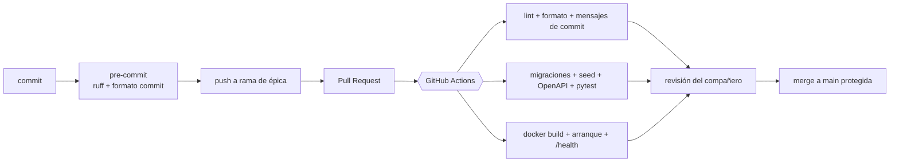
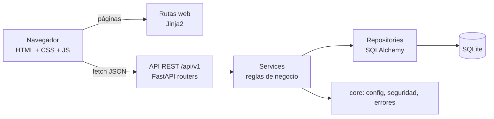

# Especificación del agente — Integrante A
**Proyecto PF-04 · Organización de eventos y actividades académicas** (Python · FastAPI · SQLite · Jinja2 · SDD · GitHub Actions · Docker)

> Copia este archivo en la raíz del repositorio de tu equipo (por ejemplo como `AGENTE_A.md`, o como `CLAUDE.md`/`AGENTS.md` si tu herramienta lo lee automáticamente) y dáselo a tu agente de programación. El otro integrante usa su propio archivo; ambos trabajan en paralelo, cada uno en su computador, en ramas distintas. Versión 3: incluye SDD con Spec Kit, DevOps, pytest y las decisiones finales aprobadas con el cliente.

## Rol y misión

Tienes la responsabilidad de la **base técnica del proyecto** (repositorio, BD, modelos, seguridad, errores, layout, `GET /health` y base de pruebas) y de los flujos de **eventos y catálogo**. Tu primer entregable (E1) desbloquea al otro integrante.

Eres un agente de desarrollo que trabaja con tu humano (Integrante A). Implementas **solo las épicas asignadas a A**, siguiendo la metodología **SDD** (spec → plan → tareas → implementación), la arquitectura, los requisitos, las reglas de negocio, el CI y el flujo de Git descritos abajo. Las demás épicas son del otro integrante; conócelas porque se integran con las tuyas, pero no las implementes.

**Tus épicas:** E1 Fundación · E2 Autenticación y roles · E3 Gestión de eventos · E4 Catálogo · E6 Asistencia · E7 Consolidado · E8-A Pruebas · E9-A Requisitos, diseño y README 1–5 · E9-B Trazabilidad y README 6–9 (cierre consolidado)
**Épicas del otro integrante (solo para coordinación):** E0 Cimientos de SDD · E5 Inscripciones y cupos · E8-B Pruebas · E10 DevOps

## Reglas de conducta del agente (aplican a todo el trabajo)

1. **Pregunta antes de asumir.** Ante cualquier duda, por pequeña que sea (requisito, nombre, regla, decisión técnica, archivo ajeno), detente y pregunta a tu humano antes de continuar. No rellenes vacíos por tu cuenta.
2. **No inventes respuestas del cliente.** Lo no confirmado se trata como supuesto S-XX y se rotula así en la documentación.
3. **Trabaja solo en lo que te corresponde** (tus épicas y archivos). Si necesitas cambiar un archivo del otro integrante o el contrato compartido, pídele a tu humano que lo coordine; no lo edites.
4. **Commit por cada cambio** con el formato de la sección de Git; `push` al terminar cada tarea. Nunca trabajes sobre `main`.
5. **Antes de cada commit:** `ruff check . && ruff format .` y verifica que la app arranca.
6. **Sin secretos ni datos reales:** nada de contraseñas, tokens ni cadenas de conexión en el repo; solo `.env.example`; solo datos ficticios.
7. **Reglas de negocio en `services/`**, acceso a datos en `repositories/`, routers delgados; no saltarse capas.
8. **Valida siempre en el servidor** y devuelve los errores con el formato uniforme y el código HTTP correcto.
9. **Cada PR** incluye propósito, cambios, pruebas efectuadas y requisitos asociados; no lo fusiones sin la aprobación del compañero.
10. **SDD primero:** antes de programar una épica, ejecuta `/speckit.specify`, `/speckit.clarify`, `/speckit.plan`, `/speckit.tasks` y `/speckit.analyze` para generar `spec.md`, `plan.md` y `tasks.md` en `specs/NNN-slug/`, **detente y pide al humano la aprobación** (puertas G1 y G2); sin spec aprobada no hay código.
11. **La spec manda:** si descubres que el comportamiento debe cambiar, actualiza primero la spec (commit `docs(specs): ...`) y luego el código.
12. **Una tarea de `tasks.md` = un commit.** Marca la tarea como hecha en `tasks.md` en el mismo commit que la completa.
13. **El CI es la puerta:** no abras PR listo con CI en rojo, no desactives ni ignores checks, y no uses `--no-verify`.
14. **Contrato de API:** si tu cambio altera endpoints o schemas, ejecuta `python scripts/export_openapi.py` y commitea `specs/contrato/openapi.json`. Ante un conflicto en ese archivo no lo edites a mano: regenéralo.
15. **Pruebas de reglas críticas:** para cupo, duplicados y permisos escribe primero la prueba pytest que falla y luego la implementación.
16. **Reporta al terminar cada tarea:** qué hiciste, el hash del commit, qué probaste y qué sigue.
17. **Decisiones finales aprobadas (no negociables sin acuerdo del cliente):** identificación única por `tipo_documento` (CC, CE, TI, PAS) + `numero_documento` con 409 `DOCUMENTO_DUPLICADO`; el correo es solo contacto y no único; Jinja2 solo como esqueleto y datos con `fetch` a `/api/v1`; fechas en UTC y presentación en `America/Bogota`; sin lista de espera; sin flujo de aprobación de eventos; ventana de asistencia de 48 h.

### Definición de terminado (por épica)

- [ ] `spec.md`, `plan.md` y `tasks.md` aprobados y consistentes con lo implementado (todas las tareas marcadas).
- [ ] Requisitos RF/RNF de la épica implementados y probados manualmente en `/docs` y en la interfaz.
- [ ] Validaciones y errores con códigos HTTP correctos; sin información sensible en errores.
- [ ] Commits atómicos y con mensaje convencional; rama subida; PR documentado y aprobado.
- [ ] Pruebas PF asignadas documentadas con evidencia y pruebas pytest de la épica en verde.
- [ ] `ruff`, `export_openapi.py --check` y CI en verde; app arranca con y sin Docker.
- [ ] Fila de la matriz de trazabilidad completada (componente, PR y prueba).

## Reparto de épicas entre los dos integrantes

| Épica | Nombre | CA | Responsable | Rama |
|---|---|---|:-:|---|
| E0 | Cimientos de SDD (constitución, plantillas) | — | **B** | `docs/E0-sdd-constitucion` |
| E1 | Fundación y plataforma | — | **A** | `001-fundacion` |
| E2 | Autenticación, roles y autorización | — | **A** | `002-autenticacion-roles` |
| E3 | Gestión de eventos | CA-01 | **A** | `003-gestion-eventos` |
| E4 | Catálogo y consulta de eventos | CA-02 | **A** | `004-catalogo-eventos` |
| E5 | Inscripciones y control de cupos | CA-03, CA-04 | **B** | `005-inscripciones-cupos` |
| E6 | Registro y consulta de asistencia | CA-05 | **A** | `006-asistencia` |
| E7 | Consolidado para coordinación | CA-06 | **A** | `007-consolidado` |
| E8 | Pruebas funcionales (PF-01…PF-12) | Todos | A: PF-01–04, 09 · B: PF-05–08, 10, 11 · ambos: PF-12 | `test/E8a-…` · `test/E8b-…` |
| E9 | Documentación y trazabilidad | Todos | A: requisitos, diseño, trazabilidad y README 1–9 (con base inicial de B en `#18`) | `docs/E9a-…` · `e9b-trazabilidad` |
| E10 | DevOps: CI, Docker, hooks, contrato OpenAPI | RNF-20…23 | **B** | `010-devops-ci-docker` |

Carga reasignada (acuerdo del equipo): A concentra el código base, los flujos de eventos y asume **E6 (Asistencia)**, **E7 (Consolidado)** y el cierre consolidado de **E9-B (Trazabilidad y README 6–9)**; B cubre E0, E10, **E5 (Inscripciones y cupos)** y **E8-B**.

### Propiedad de archivos (para evitar conflictos)

| Integrante A | Integrante B |
|---|---|
| `app/core/*`, `app/models/*`, `app/main.py`, `app/api/deps.py`, `app/api/router.py`, `migrations/`, `scripts/seed.py`, `requirements*.txt`, `.gitignore`, `.env.example`, `ruff.toml`, `tests/conftest.py`, `app/templates/base.html`, `app/static/*` | — (solo consume; propone cambios a A) |
| `*auth*`, `*evento*`, `*catalogo*`, `*asistencia*`, `*reporte*` en `schemas/`, `repositories/`, `services/`, `api/v1/`, `web/`, `templates/{auth,eventos,catalogo,asistencia,reportes}/` | `*inscripcion*` en `schemas/`, `repositories/`, `services/`, `api/v1/`, `web/`, `templates/inscripciones/` |
| `tests/test_permisos.py`, `tests/test_auth.py`, `tests/test_asistencia.py`, `tests/test_reportes.py` | `tests/test_inscripciones.py` |
| `specs/001…004-*/`, `specs/006-asistencia/`, `specs/007-consolidado/` | `.specify/memory/constitution.md`, `specs/README.md`, `.specify/templates/`, `specs/005-inscripciones-cupos/`, `specs/010-devops-ci-docker/` |
| `docs/requisitos.md`, `docs/diseno.md`, `docs/trazabilidad.md`, `docs/pruebas/PF-01…04,09`, `evidencias/PF-01…04,09` | `docs/pruebas.md`, `docs/devops.md`, `docs/pruebas/PF-05…08,10,11`, `evidencias/PF-05…08,10,11`, `evidencias/devops/` |
| `README.md` secciones 1–9 *(secciones 6–9 consolidadas sobre base inicial de B)* | — |
| — | `Dockerfile`, `docker-compose.yml`, `.dockerignore`, `.gitattributes`, `.github/`, `.pre-commit-config.yaml`, `scripts/{entrypoint.sh,check_commits.py,export_openapi.py}` |
| Compartido: `specs/contrato/openapi.json` — lo regenera con el script quien cambie la API | |

Excepciones acordadas: `inscripcion_repo.py` nace en E1 (A) con los conteos de solo lectura y desde E5 pasa a B. El botón «Inscribirse» del detalle (plantilla de E4) lo conecta B con un cambio mínimo que A revisa en el PR.

### Cómo trabajar en paralelo

1. **Fase 0 (arranque):**
   - B completa y fusiona **E0** (constitución y plantillas) lo antes posible: es pequeña y habilita las specs.
   - A, en cuanto E0 esté en `main`, escribe y aprueba la spec de E1 y entrega **E1**, luego **E2**.
   - Mientras tanto B redacta los archivos de **E10** y las specs de E5/E6/E7 (sin código).
2. **Fase 1:** A hace E3 y E4; B fusiona E10 (cuando E1 esté en `main`) y entrega E5.
3. **Fase 2:** Tras fusionarse E5, A implementa **E6** (`006-asistencia`) y luego **E7** (`007-consolidado`).
4. **Fase 3:** E8-A, E8-B, PF-12 juntos, E9 y revisión cruzada de todos los PRs.
5. **Sincronización diaria:** `git fetch && git rebase origin/main` y avisar al compañero cuando se fusione un PR que le afecte.

## Contexto y alcance del proyecto

| Campo | Valor |
|---|---|
| Proyecto | PF-04 — Organización de eventos y actividades académicas |
| Asignatura | Aplicaciones y Servicios Web — Tecnología en Desarrollo de Software |
| Guía | Versión 001 (04-11-2026) |
| Objetivo | Aplicación web con interfaz, API REST y base de datos para publicar actividades, inscribir participantes, controlar cupos y registrar asistencia |

**Dentro del alcance (obligatorio):** creación y publicación de actividades, consulta de eventos, inscripción de participantes, control de cupos y registro de asistencia, con persistencia real y consulta consolidada para coordinación.

**Fuera del alcance (la guía lo excluye):** pasarelas de pago, videoconferencias, SMS/WhatsApp, certificados firmados, integración con sistemas institucionales, lectura de QR. Despliegue en la nube y Docker no se exigen. Por decisión aprobada del equipo tampoco se implementan lista de espera, flujo de aprobación de eventos ni recuperación de contraseña.

**No es suficiente (criterio de cumplimiento):** una pantalla aislada, una API sin interfaz, datos simulados o un CRUD genérico que no represente inscripción, cupos y asistencia.

### Condiciones de aceptación obligatorias

| ID | Condición |
|---|---|
| CA-01 | El personal autorizado crea y publica actividades; quedan persistidas y aparecen en el catálogo de publicados |
| CA-02 | Los participantes consultan eventos y su disponibilidad, coherente con las inscripciones almacenadas |
| CA-03 | Un participante se inscribe; la inscripción queda persistida y es consultable |
| CA-04 | El sistema administra cupos y rechaza inscripciones que excedan el cupo o incumplan reglas aprobadas, sin alterar indebidamente los registros |
| CA-05 | El personal autorizado registra asistencia y consulta la lista de participantes (relación actividad–participante–asistencia) |
| CA-06 | Coordinación consulta información consolidada de eventos, inscripciones y asistencia |

### Evaluación (la guía prioriza el funcionamiento real)

| Criterio | Peso |
|---|---:|
| Requisitos y criterios de aceptación | 10 % |
| Arquitectura, API y modelo de datos | 10 % |
| Implementación y integración (frontend, backend, API, BD) | 45 % |
| Pruebas funcionales y documentación técnica | 20 % |
| Git/GitHub: commits, ramas, PRs, aportes verificables | 15 % |

### Restricciones técnicas de la guía

- Interfaz web + backend con API REST + base de datos, con comunicación real entre los tres.
- Pruebas funcionales documentadas (12 mínimas, Actividad 6). No se exigen pruebas automatizadas ni CI.
- Sin credenciales reales en el repositorio; `.env` fuera de Git y `.env.example` sin secretos; datos ficticios.
- Informe final = `README.md` del repositorio; documentos complementarios en el repo y enlazados desde el README.
- Repositorio: `README.md`, `.gitignore`, `.env.example`, `docs/requisitos.md`, `docs/diseno.md`, `docs/trazabilidad.md`, `evidencias/`.

### Decisiones tomadas por el equipo

| Tema | Decisión |
|---|---|
| Backend | Python + FastAPI |
| Frontend | Jinja2 solo como **esqueleto** (layout y navegación) + módulos JS (`api.js` común y un módulo por página) que consumen `/api/v1` con `fetch`. Sin bundler ni SPA |
| Base de datos | SQLite (SQLAlchemy 2.x + Alembic) |
| Trabajo en equipo | 2 integrantes en paralelo, reparto por épicas |
| Git | Commits en español con Conventional Commits; ramas por feature con el esquema de Spec Kit `NNN-slug` (p. ej. `003-gestion-eventos`); Pull Request a `main` con revisión del compañero |
| Metodología | SDD con **Spec Kit** (`/speckit.constitution → specify → clarify → plan → tasks → analyze → implement`), con puertas de aprobación G1–G5 |
| DevOps | GitHub Actions (CI) + Docker y docker-compose; hooks de pre-commit; protección de `main` |
| Pruebas automatizadas | `pytest` mínimo sobre cupo, duplicados y permisos, además de las 12 pruebas funcionales documentadas |

### Aclaraciones del cliente y decisiones finales aprobadas

Las 15 aclaraciones del cliente delegaron varias definiciones al equipo («ustedes definen»). Las siguientes decisiones fueron **aprobadas** y reemplazan a los supuestos anteriores. Se distingue lo **confirmado por el cliente** de lo **decidido por el equipo por delegación**.

| Tema | Decisión final | Origen |
|---|---|---|
| Quién se inscribe | Estudiantes y docentes (`tipo_participante`) | Cliente |
| Identificación única | `tipo_documento` (`CC`, `CE`, `TI`, `PAS`) + `numero_documento`, con `UNIQUE(tipo_documento, numero_documento)`. Duplicado → **409 `DOCUMENTO_DUPLICADO`** | Equipo (aprobada) |
| Formato del documento | Texto sin espacios ni puntos. CC, CE y TI: solo dígitos (5 a 12). PAS: alfanumérico en mayúsculas (5 a 15) | Equipo |
| Correo | Obligatorio, formato válido, **no único**, solo dato de contacto; no identifica ni sirve para iniciar sesión | Equipo |
| Autenticación | Documento + contraseña (mínimo 8 caracteres, hash **argon2id**, verificación en tiempo constante y límite de 10 intentos fallidos → 429 `DEMASIADOS_INTENTOS`), JWT `HS256` (`sub=usuario.id`) en cookie `HttpOnly` + `SameSite=Lax` + `Path=/` + `Max-Age=3600` + `Secure` siempre activa; **HTTPS en todos los entornos** (certificados `mkcert` en local, autofirmado en CI); validación `Origin`/`Referer` en mutaciones con cookie; sin recuperación de contraseña | Equipo |
| Cuentas del personal | El registro público solo crea participantes. Organizadores y coordinación se crean con `scripts/crear_usuario.py` (pide documento) y el seed | Equipo |
| Permisos | Organizador: solo sus eventos. Coordinación: solo lectura global. Participante: solo lo propio | Equipo |
| Campos del evento | Nombre (`titulo`), descripción, tipo de actividad, inicio y fin, lugar o modalidad, organizador (usuario creador), responsable (`responsable_nombre`, `responsable_correo`), cupo máximo, `fecha_limite_inscripcion`, estado; opcionales: ponente, requisitos y `publico_objetivo` (`todos`, `estudiantes`, `docentes`) | Cliente + equipo |
| Estados del evento | Guardados: `borrador`, `publicado`, `cancelado`. `finalizado` e «inscripciones cerradas» se **calculan**, no se almacenan | Equipo |
| Aprobación de eventos | **Sin flujo de aprobación**: el organizador publica directo si cumple las condiciones de publicación | Equipo |
| Condiciones de publicación | Datos completos, `fecha_fin > fecha_inicio`, `fecha_limite_inscripcion ≤ fecha_inicio`, inicio futuro y cupo ≥ 1 | Equipo |
| Cupo | Se puede subir siempre; se puede bajar solo hasta las inscripciones activas; no se edita en eventos cancelados ni finalizados | Equipo |
| Lista de espera | **No habrá** | Equipo |
| Cancelar evento | Pasa a `cancelado`, conserva sus inscripciones y bloquea inscripciones y asistencia nuevas | Equipo |
| Aceptar inscripción | Participante autenticado, evento publicado, antes de `fecha_limite_inscripcion`, cupo disponible, sin inscripción activa y cumple el público objetivo | Equipo |
| Duplicados de inscripción | Misma pareja (evento, participante) con inscripción activa → 409 `INSCRIPCION_DUPLICADA` | Equipo |
| Cancelar inscripción | Hasta el inicio del evento; libera el cupo (reutilizable solo si las inscripciones siguen abiertas); conserva el historial | Cliente (puede cancelar) + equipo (plazo) |
| Reinscripción | Permitida si cumple todas las condiciones; crea un registro nuevo y el anterior queda `cancelada` | Equipo |
| Asistencia | La registra el organizador del evento, desde `fecha_inicio` hasta **48 h después de `fecha_fin`**; estados `presente`/`ausente` (sin registro = pendiente); correcciones dentro de la ventana guardando quién y cuándo; solo inscripciones activas | Equipo |
| Consolidado | Por evento: cupo, inscritos activos, disponibles, ocupación %, cancelaciones, presentes, ausentes, sin registrar y % de asistencia (presentes ÷ inscritos activos). Totales globales = suma exacta del detalle. Filtros: rango de fechas, tipo, estado, organizador, modalidad y texto. CSV opcional al final | Cliente (consulta) + equipo |
| Fechas y zona horaria | Interfaz en español; zona `America/Bogota` (UTC-5, sin horario de verano). **Almacenamiento en UTC**; la API recibe y devuelve ISO-8601 con zona (`-05:00`); la presentación convierte a `America/Bogota`; las reglas de fechas se comparan en UTC | Cliente (UTC-5) + equipo |
| Frontend | Jinja2 como esqueleto + módulos JS que consumen `/api/v1` con `fetch`. Evidencia en PF-12 con capturas de la pestaña Red | Cliente (permite Jinja2 si se justifica y demuestra) |
| Base de datos | SQLite con integridad (FK activas, `UNIQUE`, `CHECK`, índice único parcial) | Cliente |
| Privacidad | El organizador ve el documento completo de los inscritos de su evento; coordinación lo ve enmascarado (`••••1234`); el documento no se escribe en logs ni en errores; el seed usa números ficticios obviamente falsos | Equipo |
| Visitantes | Consultan eventos publicados sin sesión; para inscribirse deben autenticarse | Cliente |

## Requisitos

Prioridad: **M** = obligatorio (cubre un CA), **S** = recomendado, **C** = opcional. Los supuestos **S-XX** no están confirmados por el cliente (ver sección de supuestos).

### Requisitos funcionales (RF)

| ID | Requisito | Prior. | CA | Épica |
|---|---|:-:|---|:-:|
| RF-01 | Registrar participantes (estudiantes o docentes) con `tipo_documento` (CC, CE, TI, PAS), `numero_documento`, nombre, correo de contacto (no único), tipo de participante y contraseña | M | CA-03 | E2 |
| RF-02 | Iniciar y cerrar sesión con documento (tipo + número) y contraseña | M | Transv. | E2 |
| RF-03 | Tres roles (participante, organizador, coordinación); cada endpoint y página valida el rol | M | CA-01/05/06 | E2 |
| RF-04 | Cuentas de organizador y coordinación creadas por seed/script administrativo (`crear_usuario.py`, que pide documento), sin auto-registro | M | CA-01 | E1/E2 |
| RF-05 | Crear evento en estado borrador: nombre (`titulo`), descripción, tipo de actividad, fecha/hora de inicio y fin, lugar o modalidad, responsable (nombre y correo), cupo máximo y fecha límite de inscripción; opcionales: ponente, requisitos y público objetivo. El organizador es el usuario creador | M | CA-01 | E3 |
| RF-06 | Editar evento propio; el cupo puede subir siempre y bajar solo hasta las inscripciones activas; no se edita en eventos cancelados ni finalizados | M | CA-01/04 | E3 |
| RF-07 | Publicar evento (borrador → publicado) sin flujo de aprobación, validando: datos completos, `fecha_fin > fecha_inicio`, `fecha_limite_inscripcion ≤ fecha_inicio`, inicio futuro y cupo ≥ 1 | M | CA-01 | E3 |
| RF-08 | Cancelar evento publicado (publicado → cancelado) con motivo | S | CA-01 | E3 |
| RF-09 | Estado «finalizado» calculado cuando pasó la fecha de fin (no se almacena) | S | CA-06 | E3 |
| RF-10 | Organizador consulta sus eventos en todos los estados | M | CA-01 | E3 |
| RF-11 | Catálogo de eventos publicados con filtros (tipo, fecha, texto) y paginación | M | CA-02 | E4 |
| RF-12 | Detalle de evento con cupo máximo, inscritos y cupos disponibles coherentes con la BD | M | CA-02 | E4 |
| RF-13 | Evento inexistente (o no publicado para quien no es autorizado) responde 404 controlado | M | CA-02 | E4 |
| RF-14 | Participante autenticado se inscribe en un evento publicado | M | CA-03 | E5 |
| RF-15 | Validar reglas de inscripción: participante autenticado, evento publicado, antes de la fecha límite, cupo disponible, sin inscripción activa duplicada y cumple el público objetivo | M | CA-04 | E5 |
| RF-16 | Rechazo atómico: una inscripción rechazada no deja registros parciales ni altera cupos | M | CA-04 | E5 |
| RF-17 | Participante consulta sus inscripciones | M | CA-03 | E5 |
| RF-18 | Participante cancela su inscripción hasta el inicio del evento; se libera el cupo (reutilizable solo con inscripciones abiertas) y se conserva el historial | S | CA-04 | E5 |
| RF-19 | Organizador consulta la lista de inscritos de sus eventos (documento completo); coordinación en solo lectura (documento enmascarado) | M | CA-05 | E5 |
| RF-20 | Registrar asistencia (presente/ausente) por inscripción activa | M | CA-05 | E6 |
| RF-21 | Corregir una asistencia ya registrada dentro de la ventana, guardando quién y cuándo | S | CA-05 | E6 |
| RF-22 | Consultar lista de participantes con su estado de asistencia | M | CA-05 | E6 |
| RF-23 | Registrar asistencia solo desde `fecha_inicio` hasta 48 h después de `fecha_fin` y solo para inscripciones activas | M | CA-05 | E6 |
| RF-24 | Consolidado por evento: cupo, inscritos activos, disponibles, ocupación %, cancelaciones, presentes, ausentes, sin registrar, % de asistencia (presentes ÷ inscritos activos) y estado | M | CA-06 | E7 |
| RF-25 | Filtros del consolidado por rango de fechas, tipo, estado, organizador, modalidad y texto | S | CA-06 | E7 |
| RF-26 | Totales globales coherentes con el detalle por evento | M | CA-06 | E7 |
| RF-27 | Interfaz web (Jinja2 como esqueleto + módulos JS con `fetch` a `/api/v1`) para todos los flujos con datos reales | M | Todos | E1–E7 |
| RF-28 | Documentación OpenAPI interactiva (`/docs`) con ejemplos de solicitud/respuesta | M | Doc. | Todas |
| RF-29 | Script de datos de prueba ficticios reproducible | M | Pruebas | E1 |
| RF-30 | Exportar el consolidado a CSV | C | CA-06 | E7 |

### Requisitos no funcionales (RNF)

| ID | Requisito | Verificación |
|---|---|---|
| RNF-01 | Arquitectura en capas: `api` (routers) → `services` (reglas de negocio) → `repositories` (acceso a datos) → `models`. Los routers no contienen reglas ni SQL | Revisión de código en PR |
| RNF-02 | Validación en el servidor con Pydantic v2 (tipos, rangos, longitudes) además de restricciones en BD | Pruebas PF-02, PF-06 |
| RNF-03 | Integridad: PK, FK (`PRAGMA foreign_keys=ON`, `PRAGMA busy_timeout=5000` por conexión), `UNIQUE(tipo_documento, numero_documento)`, `CHECK`, índice único parcial de inscripción activa y escape de comodines en `LIKE` | Migración inicial + revisión |
| RNF-04 | Concurrencia: dos inscripciones simultáneas nunca superan el cupo (transacción `BEGIN IMMEDIATE` + sentencia condicional + índice único parcial) | PF-07 + pytest con archivo temporal |
| RNF-05 | Seguridad: hash **argon2id**, verificación en tiempo constante, límite de 10 intentos fallidos en login (429), JWT `HS256` (`sub=id`) con `SECRET_KEY` validada al arranque, cookie `HttpOnly` + `SameSite=Lax` + `Path=/` + `Max-Age=3600` + `Secure` obligatoria (la app falla al arrancar si `COOKIE_SECURE` no es `true`), HTTPS en todos los entornos (certificados `mkcert` en `certs/`, nunca en Git), defensa CSRF por `Origin`/`Referer` y secretos solo en `.env` | Revisión + `.gitignore` + pytest |
| RNF-06 | Autorización de mínimo privilegio por rol y por propietario; prevenir acceso a recursos ajenos (IDOR) | PF-09 |
| RNF-07 | Errores uniformes `{"error": {"codigo", "mensaje", "detalles"}}` (incluidos `RequestValidationError` sin campo `input` y `HTTPException`); sin trazas ni datos sensibles en respuestas ni logs | Revisión + pruebas |
| RNF-08 | Códigos HTTP correctos: 200, 201, 204, 400/422, 401, 403, 404, 409, 429 | Tabla de endpoints |
| RNF-09 | Documentación: README, `docs/*`, OpenAPI; tabla de endpoints reales con requisito asociado | README |
| RNF-10 | Reproducibilidad: dependencias fijadas, migraciones Alembic, seed e instrucciones **con y sin Docker** (la guía no exige Docker) | Instalación limpia |
| RNF-11 | Mantenibilidad: PEP 8, type hints, docstrings, `ruff`; nombres de dominio en español y `snake_case`; funciones cortas | `ruff check` |
| RNF-12 | Usabilidad: mensajes claros, validación en formularios, diseño responsive básico, etiquetas accesibles | Revisión manual |
| RNF-13 | Rendimiento: listados paginados, índices en FK y columnas de filtro | Revisión de modelo |
| RNF-14 | Trazabilidad: Conventional Commits en español, ramas por épica, PRs documentados, matriz de trazabilidad | Historial Git |
| RNF-15 | Privacidad: solo datos ficticios (documentos obviamente falsos); documento enmascarado para coordinación y fuera de logs y errores | Seed + revisión |
| RNF-16 | Fechas almacenadas en UTC en ORM; la API rechaza entradas sin zona (422) y usa ISO-8601 con zona (`-05:00`); presentación con `Intl` en `America/Bogota` (`tzdata`); reglas comparadas en UTC | Revisión + pruebas |
| RNF-17 | Portabilidad: ejecutable en Windows, macOS y Linux con Python 3.11+ | README |
| RNF-18 | Pruebas funcionales documentadas obligatorias (12 mínimas, PF-01…PF-12) | `docs/pruebas/` |
| RNF-19 | SDD: ninguna épica se implementa sin `spec.md`, `plan.md` y `tasks.md` aprobados; el comportamiento cambia primero en la spec | Specs en el PR |
| RNF-20 | CI en GitHub Actions: lint, formato, formato de commits, migraciones, seed, contrato OpenAPI, pytest y build de Docker; `main` protegida | Checks del PR |
| RNF-21 | Contenedores: `Dockerfile` y `docker-compose.yml` con usuario sin privilegios, volumen nombrado para SQLite y healthcheck | `docker compose up` |
| RNF-22 | `GET /health` y logging por solicitud sin cuerpos, cabeceras `Cookie`/`Authorization` ni datos sensibles | Revisión + CI |
| RNF-23 | Pruebas automatizadas mínimas con pytest sobre cupo, duplicados y permisos (≈ 12 pruebas), sobre una BD temporal | Job `pruebas` |

### Reglas de negocio (RN)

| ID | Regla |
|---|---|
| RN-01 | Solo los eventos en estado `publicado` aparecen en el catálogo público |
| RN-02 | `cupo_maximo` es un entero ≥ 1 |
| RN-03 | `fecha_fin` > `fecha_inicio` y `fecha_limite_inscripcion` ≤ `fecha_inicio`; al publicar, `fecha_inicio` debe ser futura |
| RN-04 | Un participante tiene como máximo una inscripción **activa** por evento |
| RN-05 | No se inscribe si inscripciones activas ≥ `cupo_maximo` (no hay sobrecupo ni lista de espera) |
| RN-06 | Solo se inscribe en eventos `publicado`, antes de `fecha_limite_inscripcion`, con cupo y si cumple el público objetivo |
| RN-07 | Cancelar una inscripción (hasta el inicio del evento) la marca `cancelada`, libera el cupo y conserva el historial; reinscribirse crea un registro nuevo si cumple todas las condiciones |
| RN-08 | La asistencia solo existe para inscripciones activas, desde `fecha_inicio` hasta 48 h después de `fecha_fin` |
| RN-09 | El cupo puede subir siempre; no baja de las inscripciones activas ni se edita en eventos cancelados o finalizados |
| RN-10 | Un organizador solo gestiona sus propios eventos; coordinación solo consulta |
| RN-11 | Cancelar un evento conserva sus inscripciones y bloquea nuevas inscripciones y asistencia |
| RN-12 | Estados guardados del evento: `borrador → publicado → cancelado`; «finalizado» e «inscripciones cerradas» se calculan; no hay retrocesos |
| RN-13 | Identificación única de personas: `UNIQUE(tipo_documento, numero_documento)`; duplicado → 409 `DOCUMENTO_DUPLICADO`. El correo no es único ni identifica |
| RN-14 | Formato del documento: texto sin espacios ni puntos; CC/CE/TI solo dígitos (5–12); PAS alfanumérico en mayúsculas (5–15) |
| RN-15 | Las inscripciones se cierran en `fecha_limite_inscripcion` (≤ `fecha_inicio`) |
| RN-16 | Reinscripción tras cancelar: permitida si cumple todas las condiciones; el registro anterior queda `cancelada` |
| RN-17 | Las correcciones de asistencia solo se hacen dentro de la ventana y registran quién y cuándo |
| RN-18 | Fechas: almacenamiento en UTC, API con zona y presentación en `America/Bogota`; las comparaciones se hacen en UTC |
| RN-19 | Privacidad del documento: completo para el organizador de su evento, enmascarado (`••••1234`) para coordinación, nunca en logs ni errores (tampoco `input` de 422); en CSV opcional va enmascarado y con neutralización de fórmulas (`=`, `+`, `-`, `@`) |
| RN-20 | Sin lista de espera ni flujo de aprobación de eventos |
| RN-21 | El registro público solo crea participantes; el personal se crea por script/seed |

### Estado de los supuestos S-XX

Las aclaraciones del cliente y las decisiones finales aprobadas (sección anterior) resolvieron los supuestos originales. Se rotula quién decidió cada uno.

| ID | Tema | Estado | Resolución |
|---|---|---|---|
| S-01 | Cuentas de organizador y coordinación | Decisión del equipo (aprobada) | Script `crear_usuario.py` (pide documento) y seed |
| S-02 | Catálogo público; inscribirse requiere sesión | **Confirmado por el cliente** | Visitantes consultan sin sesión |
| S-03 | Identidad del participante | Decisión del equipo (aprobada) | Documento (`tipo_documento` + `numero_documento`); el correo es solo contacto |
| S-04 | Estados del evento | Decisión del equipo (aprobada) | `borrador`, `publicado`, `cancelado`; `finalizado` calculado |
| S-05 | Inscripción duplicada y reinscripción | Decisión del equipo (aprobada) | 409 si hay activa; tras cancelar se crea un registro nuevo |
| S-06 | Lista de espera | Decisión del equipo (aprobada) | No habrá |
| S-07 | Cierre de inscripciones | Decisión del equipo (aprobada) | `fecha_limite_inscripcion` (≤ inicio); ya no es el inicio del evento |
| S-08 | Asistencia | Decisión del equipo (aprobada) | `presente`/`ausente`, ventana de 48 h, corrección por el organizador |
| S-09 | Permisos | Decisión del equipo (aprobada) | Mínimo privilegio por rol y propietario |
| S-10 | Cancelar evento | Decisión del equipo (aprobada) | Conserva inscripciones |
| S-11 | Zona horaria | **Confirmado por el cliente** (UTC-5) | UTC en BD; `America/Bogota` en pantalla |
| S-12 | Traslape de horarios | Decisión del equipo (aprobada) | No se valida |
| S-13 | Autenticación | Decisión del equipo (aprobada) | Documento + contraseña, sin recuperación |
| S-14 | Idioma | **Confirmado por el cliente** | Español |
| S-15 | Aprobación de eventos | Decisión del equipo (aprobada) | Sin flujo de aprobación |

## Metodología SDD (Spec-Driven Development)

**Principio:** la especificación es la fuente de verdad. El código la implementa y las pruebas la verifican. **No se programa nada sin una spec aprobada**; si el comportamiento cambia, primero cambia la spec y después el código, en commits separados.

### Artefactos (de lo general a lo particular)

| Nivel | Artefacto | Ubicación | Responsable |
|:-:|---|---|---|
| 1 | Guía del docente y entrevista con el cliente | `docs/requisitos.md` | A (E9-A) |
| 2 | **Constitución** (12 principios y reglas finales) | `.specify/memory/constitution.md` | B (E0) |
| 3 | Plantillas de Spec Kit personalizadas | `.specify/templates/` | B (E0) |
| 4 | **Spec** por feature: qué y por qué, con criterios verificables | `specs/NNN-slug/spec.md` | Dueño de la épica |
| 5 | **Plan** técnico (y `research.md`, `data-model.md`, `contracts/`, `quickstart.md` cuando apliquen) | `specs/NNN-slug/plan.md` | Dueño de la épica |
| 6 | **Tareas** atómicas, cada una = un commit | `specs/NNN-slug/tasks.md` | Dueño de la épica |
| 7 | **Contrato de API** generado desde el código y verificado en CI | `specs/contrato/openapi.json` | Quien cambie la API |
| 8 | Código + pruebas (pytest y PF-01…PF-12) | `app/`, `tests/`, `docs/pruebas/` | Dueño de la épica |
| 9 | Trazabilidad CA ↔ RF ↔ spec ↔ código ↔ PR ↔ prueba | `docs/trazabilidad.md` | A (E9-B) |

Tabla épica ↔ feature (numeración de Spec Kit, definida en `specs/README.md`): E1 → `001-fundacion`, E2 → `002-autenticacion-roles`, E3 → `003-gestion-eventos`, E4 → `004-catalogo-eventos`, E5 → `005-inscripciones-cupos`, E6 → `006-asistencia`, E7 → `007-consolidado`, E10 → `010-devops-ci-docker`.

### Ciclo por épica y puertas de control

Ciclo de Spec Kit: `/speckit.constitution → specify → clarify → plan → tasks → analyze → implement`. No se ejecuta `implement` sin spec aprobada, `clarify` es obligatorio antes de `plan` y `analyze` va antes de `implement`. `checklist` es opcional.

| Paso | Qué se hace | Salida | Puerta |
|:-:|---|---|---|
| 1. Especificar | `/speckit.specify`: crea la rama `NNN-slug` y `spec.md` desde los RF/RN/CA de la épica: historias, criterios Dado/Cuando/Entonces, errores esperados, casos límite, fuera de alcance | `spec.md` | — |
| 2. Clarificar | `/speckit.clarify`: cada duda queda como `[PENDIENTE: pregunta]` y se **pregunta al humano**; lo no confirmado por el cliente queda como `[SUPUESTO S-XX]` | Spec sin pendientes bloqueantes | **G1:** el humano aprueba la spec |
| 3. Planificar | `/speckit.plan`: decisiones, archivos por capa, schemas, endpoints, modelo, riesgos y verificación contra la constitución | `plan.md` | — |
| 4. Tareas | `/speckit.tasks`: tareas ordenadas (T-NNN-01…) con dependencias, archivos, commit sugerido y criterio de terminado | `tasks.md` | — |
| 5. Analizar | `/speckit.analyze`: valida la consistencia entre spec, plan y tareas; los hallazgos críticos se corrigen | Informe sin críticos | **G2:** el humano aprueba plan y tareas; se abre un **PR en borrador** para que el compañero lea la spec |
| 6. Implementar | `/speckit.implement`: una tarea por vez, un commit por tarea; para reglas de negocio se escribe primero la prueba (pytest) | Código + pruebas | **G3:** cada tarea cumple su criterio antes de pasar a la siguiente |
| 7. Verificar | Recorrer los criterios de la spec uno a uno; ejecutar pytest, PF asignadas, `ruff` y `export_openapi.py --check` | Checklist de verificación en el PR | **G4:** CI verde |
| 8. Cerrar | Marcar el PR como listo, revisión del compañero, merge, actualizar `docs/trazabilidad.md` | PR fusionado | **G5:** aprobación del compañero |

### Plantillas (`.specify/templates/`)

Se usan las plantillas de Spec Kit (`spec-template.md`, `plan-template.md`, `tasks-template.md`, `checklist-template.md`) personalizadas en E0 para exigir, como mínimo:

- **Spec:** épica, condiciones CA-0X y requisitos RF/RN/RNF trazables; historias con criterios Dado/Cuando/Entonces; **errores esperados** (código HTTP + código de dominio); casos límite; supuestos y pendientes (`[SUPUESTO S-XX]` / `[PENDIENTE: ...]`); **verificación** con PF-XX y pruebas pytest.
- **Plan:** decisiones técnicas y alternativas descartadas; archivos por capa (api, services, repositories, schemas, web, templates, static/js); contrato y cambios en el modelo; riesgos; verificación contra la constitución.
- **Tareas:** tabla con ID, tarea, dependencias, archivos, commit sugerido (Conventional Commits en español), criterio de terminado y estado.


### Constitución del proyecto (`.specify/memory/constitution.md`)

Fuente única de los principios, generada con `/speckit.constitution`. Resumen de los 12 principios:

1. **La spec manda:** sin spec aprobada no hay código; cualquier divergencia se corrige primero en la spec.
2. **Capas estrictas:** routers → services → repositories → models; las reglas de negocio viven solo en `services/`.
3. **Validar en el servidor** y garantizar la integridad también en la BD (FK, `UNIQUE`, `CHECK`, índice parcial).
4. **El cupo nunca se excede:** la inscripción es una operación atómica; el cupo disponible se calcula, no se almacena.
5. **Mínimo privilegio:** autorización por rol y por propietario en cada endpoint y página.
6. **Errores uniformes** con código HTTP correcto y sin datos sensibles.
7. **Sin secretos ni datos reales** en el repositorio; configuración por entorno y datos ficticios.
8. **Commits atómicos** en Conventional Commits (español); una rama por feature (`NNN-slug`); PR documentado y revisado.
9. **CI verde antes de fusionar;** ningún check se desactiva para «pasar».
10. **Reproducible con y sin Docker:** README con ambas vías; mismas dependencias fijadas.
11. **Contrato compartido** (modelos, errores, dependencias, enums): solo se cambia con acuerdo de ambos integrantes.
12. **Cuando hay duda, se pregunta** al humano (y este al cliente o al docente); no se asume en silencio.

Reglas finales aprobadas (también en la constitución): identificación única por `tipo_documento` + `numero_documento` con 409 `DOCUMENTO_DUPLICADO`; correo solo de contacto; frontend Jinja2 como esqueleto + módulos JS con `fetch` a `/api/v1`; fechas en UTC con presentación en `America/Bogota`; sin lista de espera; sin flujo de aprobación de eventos; ventana de asistencia de 48 h.

### Gestión de cambios

- Cambiar comportamiento ⇒ commit `docs(specs): ...` con la spec actualizada **antes** del commit de código.
- Si el cambio afecta a una épica del otro integrante, el humano lo coordina y el compañero aprueba el cambio de spec en el PR.
- Toda spec enlaza sus RF/CA; todo commit relevante lleva pie `Refs: RF-.., CA-..` y `Spec: specs/EXX-slug`.
- Si el cliente responde una pregunta pendiente, se actualizan `docs/requisitos.md`, las specs afectadas y los supuestos S-XX (de «supuesto» a «confirmado»).

## Tus épicas en detalle

### E1 — Fundación y plataforma · Integrante A · rama `001-fundacion`

**Spec (SDD):** `specs/001-fundacion/` — se redacta y aprueba antes de escribir código.
**Objetivo:** dejar un esqueleto ejecutable que desbloquee al otro integrante: repositorio, entorno, BD, modelos, errores, contrato compartido, layout web y seed.
**Requisitos:** RF-04, RF-27 (base), RF-28, RF-29; RNF-01, 03, 05 (config), 07, 10, 11, 15, 17.

**Historias de usuario**
- **HU-E1-01** Como desarrollador quiero clonar el repo y ejecutar la app con pocos comandos. *Criterio:* siguiendo el README en un equipo limpio (entorno virtual, `mkcert` y `scripts/generar_certificados`), `uvicorn app.main:app --reload --ssl-keyfile certs/localhost-key.pem --ssl-certfile certs/localhost.pem` abre `https://localhost:8000/docs` y la página `/`.
- **HU-E1-02** Como equipo queremos un esquema de BD versionado. *Criterio:* `alembic upgrade head` crea las 4 tablas con todas las restricciones del modelo; `PRAGMA foreign_keys` está activo.
- **HU-E1-03** Como equipo queremos datos de prueba ficticios. *Criterio:* `python scripts/seed.py` crea 1 coordinación, 2 organizadores, ≥ 6 participantes y ≥ 5 eventos en distintos estados, y puede ejecutarse varias veces sin duplicar; todos los usuarios llevan documentos ficticios obviamente falsos y `scripts/crear_usuario.py` crea organizadores y coordinación pidiendo tipo y número de documento.

| # | Tarea | Commit sugerido |
|--:|---|---|
| 0 | Spec, plan y tareas (SDD) en `specs/001-fundacion/` y PR en borrador | `docs(specs): agrega spec, plan y tareas de E1` |
| 1 | Crear estructura de carpetas con stubs de todas las épicas | `chore(repo): crea estructura de capas y archivos base por épica` |
| 2 | `.gitignore` (Python, `.env`, `*.db`, `.venv`) | `chore(repo): agrega .gitignore para Python, entornos y base de datos` |
| 3 | `requirements.txt` con versiones fijadas | `chore(deps): fija dependencias de FastAPI, SQLAlchemy, Alembic y Jinja2` |
| 4 | Configuración con `pydantic-settings` + `.env.example` | `feat(core): agrega configuración por entorno y .env.example` |
| 5 | Engine SQLite con claves foráneas y WAL, `get_db()` | `feat(bd): configura SQLite con claves foráneas y sesión por solicitud` |
| 6 | Enums del dominio (rol, tipo de documento, tipo de participante, tipo de actividad, modalidad, público objetivo, estados) | `feat(bd): define enumeraciones de rol, documento, tipo, modalidad y estados` |
| 7 | Modelos `Usuario`, `Evento`, `Inscripcion`, `Asistencia` | `feat(bd): define modelos con restricciones CHECK, FK e índices` |
| 8 | Migración inicial (incluye índice único parcial) | `feat(bd): agrega migración inicial del esquema` |
| 9 | Errores de dominio y manejadores globales | `feat(core): agrega errores de dominio y manejador global con formato uniforme` |
| 10 | `deps.py` con firmas de `get_current_user` y `require_roles` (implementación en E2) | `feat(api): define interfaz de dependencias de autenticación y roles` |
| 11 | `contar_activas` y `contar_activas_por_eventos` | `feat(bd): agrega conteo de inscripciones activas por evento` |
| 12 | `router.py`, stubs de routers y rutas web | `feat(api): registra routers versionados y rutas web por épica` |
| 13 | `base.html` (esqueleto Jinja2), navegación por rol, CSS y `static/js/api.js` común (`fetch` a `/api/v1`, errores y fechas en `America/Bogota`) | `feat(web): agrega esqueleto Jinja2, navegación y cliente fetch común` |
| 14 | Seed idempotente y `crear_usuario.py` con documentos ficticios | `feat(bd): agrega scripts seed y crear_usuario con datos ficticios` |
| 15 | `ruff.toml` y formato | `chore(lint): configura ruff para lint y formato` |
| 16 | README inicial con guía detallada de entorno virtual (creación con venv/uv y activación en Windows/Linux/macOS), variables de entorno, instalación de dependencias, migración, seed y ejecución | `docs(repo): agrega README inicial con instalacion, entorno virtual y ejecucion` |
| 17 | `GET /health` y logging por solicitud | `feat(core): agrega endpoint GET /health y logging por solicitud` |
| 18 | `requirements-dev.txt` con pytest, httpx, ruff y pre-commit | `chore(deps): agrega requirements-dev.txt con pytest, httpx y ruff` |
| 19 | `tests/conftest.py` con BD temporal, cliente HTTPS (`base_url="https://testserver"`) y fábricas por rol | `test(core): agrega conftest con base de datos temporal y fábricas de datos` |
| 20 | `scripts/generar_certificados.ps1` y `.sh` (mkcert; alternativa openssl), carpeta `certs/` ignorada por Git y arranque HTTPS en el README | `chore(repo): agrega script de certificados locales y arranque por HTTPS` |

**Definido como terminado:** PR a `main` aprobado; la app arranca; migración y seed funcionan en limpio; contrato compartido documentado en `docs/diseno.md`.

### E2 — Autenticación, roles y autorización · Integrante A · rama `002-autenticacion-roles`

**Spec (SDD):** `specs/002-autenticacion-roles/` — se redacta y aprueba antes de escribir código.
**Objetivo:** identificar al usuario y proteger cada recurso según su rol.
**Requisitos:** RF-01, RF-02, RF-03, RF-04; RNF-05, 06, 07, 08.

**Historias de usuario**
- **HU-E2-01** Como participante quiero registrarme con tipo y número de documento, nombre, correo, tipo de participante y contraseña. *Criterios:* documento repetido → 409 `DOCUMENTO_DUPLICADO` (el mismo número con otro tipo es válido); el correo repetido se acepta; contraseña < 8 caracteres, correo inválido o documento con formato inválido → 422; la respuesta nunca incluye el hash.
- **HU-E2-02** Como usuario quiero iniciar y cerrar sesión con mi documento y contraseña. *Criterios:* credenciales válidas → cookie `HttpOnly` y 200; inválidas → 401 sin indicar si falló el documento o la contraseña; logout borra la cookie.
- **HU-E2-03** Como sistema quiero limitar acciones por rol. *Criterios:* sin sesión → 401; rol insuficiente → 403 `SIN_PERMISO`; páginas protegidas redirigen a `/login`.

| # | Tarea | Commit sugerido |
|--:|---|---|
| 0 | Spec, plan y tareas (SDD) en `specs/002-autenticacion-roles/` y PR en borrador | `docs(specs): agrega spec, plan y tareas de E2` |
| 1 | Hash de contraseñas (argon2/bcrypt) | `feat(auth): agrega hash y verificación de contraseñas` |
| 2 | Emisión y validación de JWT con expiración | `feat(auth): agrega emisión y validación de tokens JWT` |
| 3 | Schemas de registro, login y usuario público | `feat(auth): agrega schemas de registro, login y usuario` |
| 4 | Repositorio de usuarios | `feat(auth): agrega repositorio de usuarios` |
| 5 | Servicio de registro con validación y normalización de documento único | `feat(auth): implementa servicio de registro de participantes` |
| 6 | `POST /auth/registro` | `feat(auth): expone POST /auth/registro` |
| 7 | `POST /auth/login` y `POST /auth/logout` con cookie segura | `feat(auth): implementa login y logout con cookie HttpOnly` |
| 8 | `GET /auth/yo` | `feat(auth): expone GET /auth/yo` |
| 9 | Implementar `get_current_user`, `get_current_user_optional`, `require_roles` | `feat(auth): implementa dependencias de usuario actual y control por rol` |
| 10 | Páginas `/login` y `/registro` con validación en el formulario | `feat(web): agrega páginas de inicio de sesión y registro` |
| 11 | Navegación según rol | `feat(web): muestra opciones de menú según el rol` |
| 12 | Documentar pruebas de autorización asignadas | `docs(pruebas): documenta casos de acceso sin sesión y con rol insuficiente` |
| 13 | `tests/test_permisos.py`: 401 sin sesión y 403 por rol | `test(auth): agrega pruebas de acceso sin sesión y con rol insuficiente` |

**Definido como terminado:** PR aprobado; Swagger funciona con la cookie de sesión; PF-09 documentable.

### E3 — Gestión de eventos · Integrante A · rama `003-gestion-eventos` · **CA-01**

**Spec (SDD):** `specs/003-gestion-eventos/` — se redacta y aprueba antes de escribir código.
**Objetivo:** el organizador crea, edita, publica y cancela sus actividades.
**Requisitos:** RF-05 a RF-10; RN-01 a RN-03, RN-09, RN-10, RN-12; RNF-02, 06, 08.

**Historias de usuario**
- **HU-E3-01** Como organizador quiero crear un evento en borrador. *Criterios:* datos válidos → 201 y estado `borrador`; título vacío, cupo < 1, `fecha_fin` ≤ `fecha_inicio` o `fecha_limite_inscripcion` > `fecha_inicio` → 422 sin persistir nada.
- **HU-E3-02** Como organizador quiero publicar mi evento sin aprobación previa. *Criterios:* solo desde `borrador`, con datos completos, inicio futuro, `fecha_limite_inscripcion` ≤ `fecha_inicio` y cupo ≥ 1; luego aparece en el catálogo; otro organizador recibe 403; publicar un evento ya publicado → 409.
- **HU-E3-03** Como organizador quiero editar mi evento. *Criterios:* puedo subir el cupo siempre; no puedo bajarlo por debajo de las inscripciones activas (409); no puedo editar un evento cancelado o finalizado (cupo incluido).
- **HU-E3-04** Como organizador quiero cancelar un evento publicado indicando el motivo. *Criterios:* pasa a `cancelado`, deja de aceptar inscripciones y las existentes se conservan.
- **HU-E3-05** Como organizador quiero ver todos mis eventos con su estado y ocupación.

| # | Tarea | Commit sugerido |
|--:|---|---|
| 0 | Spec, plan y tareas (SDD) en `specs/003-gestion-eventos/` y PR en borrador | `docs(specs): agrega spec, plan y tareas de E3` |
| 1 | Schemas `EventoCrear`, `EventoActualizar`, `EventoSalida` con validaciones | `feat(eventos): agrega schemas de evento con validaciones de entrada` |
| 2 | Repositorio de eventos | `feat(eventos): agrega repositorio de eventos` |
| 3 | Servicio: crear con reglas RN-02 y RN-03 | `feat(eventos): implementa creación de eventos en borrador` |
| 4 | `POST /eventos` | `feat(eventos): expone POST /eventos para organizadores` |
| 5 | Servicio y endpoint de edición con RN-09 | `feat(eventos): implementa edición con control de cupo mínimo` |
| 6 | Servicio y endpoint de publicación | `feat(eventos): implementa publicación de eventos` |
| 7 | Servicio y endpoint de cancelación con motivo | `feat(eventos): implementa cancelación de eventos con motivo` |
| 8 | Cálculo del estado `finalizado` por fecha (no se almacena) | `feat(eventos): calcula estado finalizado según fecha de fin` |
| 9 | `GET /organizador/eventos` | `feat(eventos): expone listado de eventos propios del organizador` |
| 10 | Verificación de propietario (RN-10) | `feat(eventos): restringe la gestión al organizador propietario` |
| 11 | Páginas: formulario crear/editar y «mis eventos» | `feat(web): agrega formulario y listado de eventos del organizador` |
| 12 | Documentar PF-01, PF-02 y parte de PF-09 | `docs(pruebas): documenta PF-01, PF-02 y PF-09 con evidencias` |
| 13 | Pruebas de propiedad del evento en `tests/test_permisos.py` | `test(eventos): agrega pruebas de propiedad del evento por organizador` |

**Definido como terminado:** flujo crear → publicar visible en catálogo (junto con E4); errores 403/404/409/422 verificados.

### E4 — Catálogo y consulta de eventos · Integrante A · rama `004-catalogo-eventos` · **CA-02**

**Spec (SDD):** `specs/004-catalogo-eventos/` — se redacta y aprueba antes de escribir código.
**Objetivo:** que cualquier persona consulte los eventos publicados y su disponibilidad real.
**Requisitos:** RF-11, RF-12, RF-13; RN-01; RNF-13.

**Historias de usuario**
- **HU-E4-01** Como visitante quiero ver el catálogo de eventos publicados. *Criterios:* solo `publicado`; ordenado por fecha de inicio; paginado; filtros por tipo, rango de fechas y texto.
- **HU-E4-02** Como visitante quiero ver el detalle y los cupos disponibles. *Criterios:* `cupos_disponibles = cupo_maximo − inscripciones activas` coincide con la BD; tras inscribir o cancelar, el valor cambia; el detalle indica si las inscripciones están abiertas (calculado con `fecha_limite_inscripcion`) y las fechas se muestran en `America/Bogota`.
- **HU-E4-03** Como visitante, si abro un evento inexistente o no publicado recibo un 404 controlado con el formato de error estándar y una página amigable.

| # | Tarea | Commit sugerido |
|--:|---|---|
| 0 | Spec, plan y tareas (SDD) en `specs/004-catalogo-eventos/` y PR en borrador | `docs(specs): agrega spec, plan y tareas de E4` |
| 1 | Schemas de catálogo y paginación | `feat(catalogo): agrega schemas de catálogo y paginación` |
| 2 | Consulta de publicados con filtros y orden estable | `feat(catalogo): implementa consulta de eventos publicados con filtros` |
| 3 | Cálculo de cupos con `contar_activas_por_eventos` (evitar N+1) | `feat(catalogo): calcula cupos disponibles en una sola consulta` |
| 4 | `GET /catalogo/eventos` | `feat(catalogo): expone GET /catalogo/eventos` |
| 5 | `GET /catalogo/eventos/{id}` con 404 controlado | `feat(catalogo): expone detalle de evento con manejo de inexistente` |
| 6 | Página de catálogo con filtros y paginación | `feat(web): agrega página de catálogo con filtros` |
| 7 | Página de detalle con disponibilidad y botón de inscripción (lo conecta E5) | `feat(web): agrega página de detalle de evento con cupos` |
| 8 | Documentar PF-03 y PF-04 | `docs(pruebas): documenta PF-03 y PF-04 con evidencias` |

**Definido como terminado:** catálogo y detalle consumen la API real; cupos coherentes tras operaciones de E5.

### E8-A — Pruebas funcionales (eventos y acceso) · Integrante A · rama `test/E8a-pruebas-eventos-acceso`

Ejecutar y documentar **PF-01, PF-02, PF-03, PF-04 y PF-09** en `docs/pruebas/PF-XX.md` con la evidencia en `evidencias/PF-XX/`. Cada archivo registra: identificador, requisito asociado, condiciones iniciales, pasos, datos de entrada, resultado esperado, resultado obtenido, estado (aprobada/fallida), evidencia y método/código HTTP.

| Commit sugerido |
|---|
| `docs(pruebas): agrega plantilla de documentación de pruebas funcionales` |
| `docs(pruebas): registra resultados y evidencias de PF-01 y PF-02` |
| `docs(pruebas): registra resultados y evidencias de PF-03 y PF-04` |
| `docs(pruebas): registra resultados y evidencias de PF-09` |

Si una prueba falla: abrir `fix/<épica>-<slug>` sobre la épica afectada, corregir con commit `fix(...)`, repetir la prueba y registrar ambos resultados.

### E9-A — Requisitos, diseño y README (secciones 1–5) · Integrante A · rama `docs/E9a-requisitos-diseno`

Entregables: `docs/requisitos.md` (método de levantamiento, **registro de la entrevista**, RF/RNF/RN, historias y criterios, supuestos marcados como no confirmados hasta recibir respuesta del cliente), `docs/diseno.md` (diagrama de componentes, modelo de datos, especificación de API, prototipos/capturas, justificación de tecnologías y de la elección de Jinja2 como frontend), y README secciones 1 a 5 (información general, descripción, requisitos, arquitectura, configuración del entorno, **con la vía local y un enlace a `docs/devops.md` para Docker**) y el enlace desde `docs/diseno.md` a las specs de `specs/`.

| Commit sugerido |
|---|
| `docs(requisitos): agrega requisitos funcionales, no funcionales y reglas de negocio` |
| `docs(requisitos): registra entrevista con el cliente y supuestos pendientes` |
| `docs(diseno): agrega arquitectura, modelo de datos y especificación de API` |
| `docs(diseno): agrega prototipos de interfaz y justificación de tecnologías` |
| `docs(repo): completa secciones 1 a 5 del README` |

**Regla:** nunca inventar respuestas del cliente; lo no confirmado se rotula «Supuesto pendiente de confirmación».

### E9-B — Trazabilidad y README (secciones 6–9) · Integrante A · rama `e9b-trazabilidad`

*(Reasignada a Integrante A para consolidar y completar la entrega final tras el borrador inicial de B en `#18` y la integración de los PRs `#19`–`#23`.)*

Entregables: `docs/trazabilidad.md` (CA-01…CA-06 ↔ requisito ↔ componente ↔ PR ↔ prueba, con enlaces reales y registro completo de PRs `#1`–`#23`), `README.md` secciones 6 a 9 (tabla de endpoints reales con ejemplos y errores de dominio, pruebas y evidencias actualizadas, control de versiones con aportes verificables de cada integrante, conclusiones y limitaciones).

## Épicas del otro integrante (referencia de integración)

### E0 — Cimientos de SDD con Spec Kit · Integrante B · rama `docs/E0-sdd-constitucion`

**Spec (SDD):** esta épica configura el propio marco; no tiene spec previa.
**Objetivo:** dejar Spec Kit configurado (`.specify/`), la constitución con los 12 principios y las reglas finales aprobadas, y las plantillas personalizadas, antes de que cualquier feature escriba su spec. Es pequeña y se fusiona primero.
**Requisitos:** RNF-14, RNF-19.

**Historias de usuario**
- **HU-E0-01** Como integrante quiero una constitución vigente. *Criterio:* `.specify/memory/constitution.md` contiene los 12 principios y las reglas finales (documento único, DOCUMENTO_DUPLICADO, UTC, sin lista de espera, sin aprobación de eventos, ventana de 48 h).
- **HU-E0-02** Como integrante quiero plantillas que exijan trazabilidad. *Criterio:* las plantillas de `.specify/templates/` exigen RF/RN/CA trazables, errores esperados y verificación PF/pytest.
- **HU-E0-03** Como integrante quiero conocer el ciclo y las puertas. *Criterio:* `specs/README.md` explica el ciclo de Spec Kit, las puertas G1–G5, la gestión de cambios y la tabla épica ↔ número de feature.

| # | Tarea | Commit sugerido |
|--:|---|---|
| 1 | Verificar la inicialización de Spec Kit y la estructura `specs/` y `specs/contrato/.gitkeep` | `chore(specs): verifica estructura de Spec Kit y carpeta de contrato` |
| 2 | Redactar la constitución (`/speckit.constitution`) | `docs(specs): agrega constitución del proyecto` |
| 3 | Personalizar las plantillas de spec, plan y tareas | `docs(specs): personaliza plantillas de Spec Kit con trazabilidad` |
| 4 | `specs/README.md` con ciclo, puertas y tabla épica ↔ feature | `docs(specs): documenta ciclo SDD, puertas de control y gestión de cambios` |

**Definido como terminado:** PR aprobado por A y fusionado en `main` antes de que A abra su spec de E1.

### E5 — Inscripciones y control de cupos · Integrante B · rama `005-inscripciones-cupos` · **CA-03 y CA-04**

**Spec (SDD):** `specs/005-inscripciones-cupos/` — se redacta y aprueba antes de escribir código.
**Objetivo:** inscribir participantes garantizando que nunca se exceda el cupo ni se dupliquen inscripciones.
**Requisitos:** RF-14 a RF-19; RN-04 a RN-07, RN-11; RNF-03, 04, 06, 08.

**Historias de usuario**
- **HU-E5-01** Como participante quiero inscribirme en un evento publicado. *Criterios:* 201 y la inscripción queda `activa`; aparece en «mis inscripciones»; el cupo disponible baja en 1.
- **HU-E5-02** Como sistema quiero rechazar inscripciones inválidas sin alterar datos. *Criterios:* cupo agotado → 409 `CUPO_AGOTADO`; ya inscrito → 409 `INSCRIPCION_DUPLICADA`; evento no publicado o cancelado → 409; plazo vencido → 409 `INSCRIPCIONES_CERRADAS`; público objetivo incompatible → 409 `PUBLICO_NO_PERMITIDO`; evento inexistente → 404; en todos los casos el conteo de inscripciones y el cupo no cambian.
- **HU-E5-03** Como participante quiero cancelar mi inscripción hasta el inicio del evento. *Criterios:* queda `cancelada` (se conserva el historial), el cupo se libera y puedo reinscribirme (registro nuevo) si cumplo todas las condiciones, incluida la fecha límite; después del inicio → 409 `CANCELACION_NO_PERMITIDA`; no puedo cancelar la de otra persona (403/404).
- **HU-E5-04** Como organizador quiero ver quiénes están inscritos en mi evento (documento completo); coordinación puede verlo en solo lectura con el documento enmascarado (`••••1234`). *Criterios:* solo inscripciones activas por defecto; otro organizador recibe 403.
- **HU-E5-05** Como participante quiero ver mis inscripciones con el estado de cada evento.

| # | Tarea | Commit sugerido |
|--:|---|---|
| 0 | Spec, plan y tareas (SDD) en `specs/005-inscripciones-cupos/` y PR en borrador | `docs(specs): agrega spec, plan y tareas de E5` |
| 1 | Schemas de inscripción (entrada/salida) | `feat(inscripciones): agrega schemas de inscripción` |
| 2 | Repositorio: alta atómica condicionada al cupo, consulta por participante y por evento | `feat(inscripciones): agrega repositorio con alta atómica condicionada al cupo` |
| 3 | Servicio: reglas RN-04 a RN-06 con errores tipados | `feat(inscripciones): implementa reglas de cupo, duplicado y estado del evento` |
| 4 | `POST /eventos/{id}/inscripciones` | `feat(inscripciones): expone POST de inscripción a un evento` |
| 5 | Mapeo de conflictos a 409 con códigos específicos | `feat(inscripciones): diferencia cupo agotado e inscripción duplicada en errores` |
| 6 | Cancelación de inscripción propia | `feat(inscripciones): implementa cancelación de inscripción con liberación de cupo` |
| 7 | `GET /inscripciones/mias` | `feat(inscripciones): expone listado de inscripciones del participante` |
| 8 | `GET /eventos/{id}/inscripciones` con control de propietario/coordinación | `feat(inscripciones): expone lista de inscritos para organizador y coordinación` |
| 9 | Conectar botón «Inscribirse» en el detalle (archivo de E4, coordinar vía PR de A) | `feat(web): conecta botón de inscripción con la API y muestra errores` |
| 10 | Página «Mis inscripciones» | `feat(web): agrega página de mis inscripciones con cancelación` |
| 11 | Verificación manual de cupo con 2 solicitudes simultáneas para PF-07 | `docs(pruebas): registra verificación manual de cupo bajo simultaneidad` |
| 12 | Documentar PF-05 a PF-08 | `docs(pruebas): documenta PF-05 a PF-08 con evidencias` |
| 13 | `tests/test_inscripciones.py`: cupo agotado, liberación, duplicado y simultaneidad | `test(inscripciones): agrega pruebas de cupo, duplicados y solicitudes simultáneas` |

**Definido como terminado:** PF-05 a PF-08 aprobadas; el cupo nunca se excede incluso con solicitudes simultáneas.

### E6 — Registro y consulta de asistencia · Integrante A (reasignada) · rama `006-asistencia` · **CA-05**

**Spec (SDD):** `specs/006-asistencia/` — se redacta y aprueba antes de escribir código.
**Objetivo:** registrar quién asistió y conservar la relación actividad–participante–asistencia.
**Requisitos:** RF-20 a RF-23; RN-08, RN-10, RN-11; RNF-06, 08.

**Historias de usuario**
- **HU-E6-01** Como organizador quiero marcar presente/ausente a cada inscrito de mi evento. *Criterios:* 200 y queda persistido con quién y cuándo lo registró; no puedo registrar asistencia fuera de la ventana (desde `fecha_inicio` hasta 48 h después de `fecha_fin`) (409 `ASISTENCIA_NO_PERMITIDA`); no para inscripciones canceladas ni en eventos cancelados.
- **HU-E6-02** Como organizador quiero corregir una asistencia ya registrada dentro de la ventana (se actualiza el mismo registro, sin duplicar, y se guarda quién y cuándo).
- **HU-E6-03** Como organizador o coordinación quiero consultar la lista de participantes con su asistencia. *Criterios:* incluye documento (completo para el organizador, enmascarado para coordinación), nombre, correo, estado de inscripción y asistencia (`presente`, `ausente` o pendiente); otro organizador recibe 403.
- **HU-E6-04** Como organizador quiero una pantalla con la lista y casillas para marcar asistencia rápidamente.

| # | Tarea | Commit sugerido |
|--:|---|---|
| 0 | Spec, plan y tareas (SDD) en `specs/006-asistencia/` y PR en borrador | `docs(specs): agrega spec, plan y tareas de E6` |
| 1 | Schemas de asistencia | `feat(asistencia): agrega schemas de asistencia` |
| 2 | Repositorio de asistencia (upsert por inscripción) | `feat(asistencia): agrega repositorio con upsert por inscripción` |
| 3 | Servicio con RN-08 y verificación de propietario | `feat(asistencia): implementa reglas de registro y corrección de asistencia` |
| 4 | `PUT /eventos/{id}/inscripciones/{insc_id}/asistencia` | `feat(asistencia): expone endpoint para registrar y corregir asistencia` |
| 5 | `GET /eventos/{id}/asistencia` | `feat(asistencia): expone lista de participantes con asistencia` |
| 6 | Página de asistencia con casillas | `feat(web): agrega pantalla de registro de asistencia` |
| 7 | Documentar PF-10 | `docs(pruebas): documenta PF-10 con evidencias` |
| 8 | `tests/test_asistencia.py`: permisos y regla de inicio | `test(asistencia): agrega pruebas de permisos y regla de inicio del evento` |

**Definido como terminado:** PF-10 aprobada; no existen dos registros de asistencia para una misma inscripción.

### E7 — Consolidado para coordinación · Integrante A (reasignada) · rama `007-consolidado` · **CA-06**

**Spec (SDD):** `specs/007-consolidado/` — se redacta y aprueba antes de escribir código.
**Objetivo:** que coordinación consulte cantidades coherentes de eventos, inscripciones y asistencia.
**Requisitos:** RF-24, RF-25, RF-26, RF-30 (opcional); RNF-06, 13.

**Historias de usuario**
- **HU-E7-01** Como coordinación quiero ver por evento: cupo, inscritos activos, disponibles, ocupación %, cancelaciones, presentes, ausentes, sin registrar, % de asistencia (presentes ÷ inscritos activos) y estado. *Criterios:* los valores coinciden con las listas de E5 y E6; con 0 inscritos el % es 0 (sin división por cero).
- **HU-E7-02** Como coordinación quiero filtrar por rango de fechas, tipo, estado, organizador, modalidad y texto, y ver el detalle de participantes con su asistencia.
- **HU-E7-03** Como coordinación quiero totales globales (eventos, inscripciones, asistentes) que sumen exactamente el detalle mostrado.
- **HU-E7-04** (Opcional) Como coordinación quiero exportar el consolidado a CSV.

| # | Tarea | Commit sugerido |
|--:|---|---|
| 0 | Spec, plan y tareas (SDD) en `specs/007-consolidado/` y PR en borrador | `docs(specs): agrega spec, plan y tareas de E7` |
| 1 | Schemas del consolidado | `feat(reportes): agrega schemas de consolidado y totales` |
| 2 | Consulta agregada con `GROUP BY` (una sola consulta) | `feat(reportes): implementa consulta agregada de eventos, inscripciones y asistencia` |
| 3 | Servicio: porcentajes, totales y filtros | `feat(reportes): calcula porcentaje de asistencia y totales globales` |
| 4 | `GET /reportes/consolidado` solo coordinación | `feat(reportes): expone GET /reportes/consolidado para coordinación` |
| 5 | Página del panel con tabla, filtros y totales | `feat(web): agrega panel consolidado para coordinación` |
| 6 | (Opcional) Exportación CSV | `feat(reportes): agrega exportación del consolidado a CSV` |
| 7 | Documentar PF-11 | `docs(pruebas): documenta PF-11 con verificación de totales` |
| 8 | `tests/test_reportes.py`: acceso solo coordinación y totales | `test(reportes): agrega pruebas de acceso y coherencia de totales` |

**Definido como terminado:** PF-11 aprobada; coordinación accede y los demás roles reciben 403.

### E10 — DevOps y calidad continua · Integrante B · rama `010-devops-ci-docker`

**Spec (SDD):** `specs/010-devops-ci-docker/`
**Objetivo:** CI automático y entorno idéntico para ambos integrantes con Docker.
**Requisitos:** RNF-10, RNF-20, RNF-21, RNF-22, RNF-23.
**Dependencia:** necesita `requirements.txt`, `app/main.py`, `GET /health` y `ruff.toml` de E1; B redacta los archivos en Fase 0 y los valida cuando E1 esté en `main`.

**Historias de usuario**
- **HU-E10-01** Como integrante quiero levantar toda la app con un comando. *Criterio:* `docker compose up --build` en un equipo limpio sirve `/docs`, aplica migraciones y conserva la BD entre reinicios.
- **HU-E10-02** Como equipo queremos que cada PR se valide solo. *Criterio:* en cada PR corren `calidad`, `pruebas` y `docker`; un fallo bloquea la fusión.
- **HU-E10-03** Como equipo queremos detectar desvíos entre código y contrato. *Criterio:* `export_openapi.py --check` falla si cambió la API sin regenerar `specs/contrato/openapi.json`.
- **HU-E10-04** Como equipo queremos commits y PRs consistentes. *Criterio:* el hook y el CI rechazan mensajes que no cumplen el formato; el PR carga la plantilla.

| # | Tarea | Commit sugerido |
|--:|---|---|
| 0 | Spec, plan y tareas (SDD) en `specs/010-devops-ci-docker/` y PR en borrador | `docs(specs): agrega spec, plan y tareas de E10` |
| 1 | `Dockerfile`, `.dockerignore`, `scripts/entrypoint.sh`, `.gitattributes` | `build(docker): agrega imagen de la aplicación con entrypoint de migración` |
| 2 | `docker-compose.yml` con volumen nombrado y montaje de `./certs` (solo lectura) para HTTPS | `build(docker): agrega docker-compose con volumen persistente para SQLite` |
| 3 | `scripts/check_commits.py` | `ci(commits): agrega validador de Conventional Commits` |
| 4 | `scripts/export_openapi.py` y primer `specs/contrato/openapi.json` | `ci(specs): agrega exportación y verificación del contrato OpenAPI` |
| 5 | `.pre-commit-config.yaml` | `chore(ci): agrega hooks de pre-commit y validación del mensaje de commit` |
| 6 | Workflow job `calidad` | `ci: agrega job de lint, formato y mensajes de commit` |
| 7 | Workflow job `pruebas` | `ci: agrega job de migraciones, seed, contrato OpenAPI y pytest` |
| 8 | Workflow job `docker` (certificado autofirmado con `openssl` y verificación de `/health` por HTTPS) | `ci: agrega job de build y verificación de /health en Docker` |
| 9 | `.github/pull_request_template.md` y `.github/CODEOWNERS` (preguntar los usuarios de GitHub) | `chore(repo): agrega plantilla de PR y CODEOWNERS` |
| 10 | `docs/devops.md` con Docker, CI y protección de `main` | `docs(devops): documenta ejecución con Docker, CI y protección de main` |
| 11 | Protección de `main` (la hace el humano) y captura en `evidencias/devops/` | `docs(devops): agrega evidencia de la protección de main` |

**Definido como terminado:** los tres jobs pasan en un PR de prueba; la app corre con y sin Docker; la protección de `main` está activa.

## DevOps y calidad continua

**Alcance:** integración continua con GitHub Actions + contenedores con Docker/docker-compose para que ambos integrantes ejecuten el proyecto de forma idéntica. La guía no exige Docker, CI ni pruebas automatizadas, por lo que **el README debe documentar también la ejecución local sin Docker** (quien evalúe puede no tenerlo).

### Pipeline



### Entregables (épica E10, Integrante B)

| Archivo | Propósito |
|---|---|
| `Dockerfile`, `.dockerignore`, `scripts/entrypoint.sh`, `.gitattributes` | Imagen reproducible; el entrypoint migra y arranca |
| `docker-compose.yml` | Servicio `web` con volumen nombrado para SQLite |
| `.github/workflows/ci.yml` | Calidad, pruebas y build de Docker en cada PR y en `main` |
| `.pre-commit-config.yaml` | Checks locales antes de cada commit |
| `scripts/check_commits.py` | Valida el formato de Conventional Commits (local y CI) |
| `scripts/export_openapi.py` | Exporta `specs/contrato/openapi.json` y detecta desvíos (`--check`) |
| `.github/pull_request_template.md` | Plantilla de PR con propósito, cambios, pruebas, requisitos y spec |
| `.github/CODEOWNERS` | Revisor automático: cada integrante revisa lo del otro |
| `docs/devops.md` | Guía de ejecución con Docker, CI, protección de `main` y evidencias |

Dependientes de E1 (A): `GET /health`, `requirements.txt`, `requirements-dev.txt` (pytest, httpx, ruff, pre-commit), `ruff.toml` y `tests/conftest.py`.

### Docker

`Dockerfile` (imagen `python:3.12-slim`, usuario sin privilegios, healthcheck contra `/health`):

```dockerfile
FROM python:3.12-slim
ENV PYTHONDONTWRITEBYTECODE=1 PYTHONUNBUFFERED=1
WORKDIR /app
RUN useradd --create-home --uid 1000 appuser && mkdir -p /app/data && chown appuser /app/data
COPY requirements.txt .
RUN pip install --no-cache-dir -r requirements.txt
COPY --chown=appuser:appuser . .
USER appuser
EXPOSE 8000
HEALTHCHECK --interval=30s --timeout=5s --retries=3 \
  CMD python -c "import ssl, urllib.request; urllib.request.urlopen('https://localhost:8000/health', context=ssl._create_unverified_context())" || exit 1
ENTRYPOINT ["sh", "scripts/entrypoint.sh"]
```

`scripts/entrypoint.sh`:

```sh
#!/bin/sh
set -e
alembic upgrade head
exec uvicorn app.main:app --host 0.0.0.0 --port 8000 \
  --ssl-keyfile /app/certs/localhost-key.pem --ssl-certfile /app/certs/localhost.pem
```

`docker-compose.yml` (volumen **nombrado**, no bind mount: SQLite con WAL da problemas sobre carpetas montadas en Windows):

```yaml
services:
  web:
    build: .
    ports:
      - "8000:8000"
    env_file: .env
    environment:
      DATABASE_URL: sqlite:///./data/eventos.db
    volumes:
      - eventos_data:/app/data
      - ./certs:/app/certs:ro      # certificados locales (mkcert), nunca en Git
volumes:
  eventos_data:
```

`.gitattributes`: `*.sh text eol=lf` (evita que Windows rompa el entrypoint). `.dockerignore`: `.git`, `.venv`, `__pycache__`, `*.db`, `.env`, `certs/`, `evidencias/`, `docs/` (los certificados se montan por volumen, no se copian a la imagen).

Comandos:

```bash
cp .env.example .env                                # una sola vez
pwsh scripts/generar_certificados.ps1               # (o sh scripts/generar_certificados.sh) una sola vez, crea certs/
docker compose up --build                           # app en https://localhost:8000 (docs en /docs)
docker compose run --rm web python scripts/seed.py  # datos ficticios
docker compose exec web pytest -q                   # pruebas dentro del contenedor
docker compose down -v                              # detener y borrar la BD de desarrollo
```

Sin Docker: `python -m venv .venv`, instalar `requirements-dev.txt`, `mkcert -install` y `scripts/generar_certificados` (crea `certs/`), `alembic upgrade head`, `python scripts/seed.py`, `uvicorn app.main:app --reload --ssl-keyfile certs/localhost-key.pem --ssl-certfile certs/localhost.pem` (sirve en `https://localhost:8000`). Sin `mkcert`, alternativa con `openssl` documentada en el README.

### Variables de entorno (`.env.example`, sin secretos reales)

| Variable | Ejemplo | Uso |
|---|---|---|
| `APP_ENV` | `development` | Entorno |
| `DATABASE_URL` | `sqlite:///./data/eventos.db` | Conexión a SQLite |
| `SECRET_KEY` | `cambia-esto-en-tu-.env-local` | Firma de JWT (valor real solo en tu `.env`) |
| `ACCESS_TOKEN_MINUTES` | `60` | Vigencia de la sesión |
| `COOKIE_SECURE` | `true` | **Obligatorio `true`** (HTTPS en todos los entornos); la app falla al arrancar si es `false` |
| `LOG_LEVEL` | `INFO` | Nivel de logs |
| `APP_TIMEZONE` | `America/Bogota` | Zona de presentación (el almacenamiento es UTC; requiere `tzdata` en `requirements.txt`) |

### GitHub Actions (`.github/workflows/ci.yml`)

```yaml
name: CI
on:
  pull_request:
  push:
    branches: [main]
permissions:
  contents: read

jobs:
  calidad:
    runs-on: ubuntu-latest
    steps:
      - uses: actions/checkout@v4
        with: { fetch-depth: 0 }
      - uses: actions/setup-python@v5
        with: { python-version: "3.12", cache: pip }
      - run: pip install -r requirements-dev.txt
      - run: ruff check .
      - run: ruff format --check .
      - name: Formato de los mensajes de commit
        if: github.event_name == 'pull_request'
        run: python scripts/check_commits.py "origin/${{ github.base_ref }}..HEAD"

  pruebas:
    runs-on: ubuntu-latest
    env:
      DATABASE_URL: sqlite:///./ci.db
      SECRET_KEY: clave-solo-para-ci
    steps:
      - uses: actions/checkout@v4
      - uses: actions/setup-python@v5
        with: { python-version: "3.12", cache: pip }
      - run: pip install -r requirements-dev.txt
      - run: alembic upgrade head
      - run: python scripts/seed.py
      - name: Contrato OpenAPI sin desvíos
        run: python scripts/export_openapi.py --check
      - run: pytest -q

  docker:
    runs-on: ubuntu-latest
    steps:
      - uses: actions/checkout@v4
      - run: cp .env.example .env
      - name: Certificado autofirmado para HTTPS
        run: |
          mkdir -p certs
          openssl req -x509 -newkey rsa:2048 -nodes -days 1 -subj "/CN=localhost" \
            -keyout certs/localhost-key.pem -out certs/localhost.pem
      - run: docker compose up -d --build
      - name: Esperar /health
        run: |
          for i in $(seq 1 20); do
            curl -fsk https://localhost:8000/health && exit 0
            sleep 3
          done
          docker compose logs web
          exit 1
      - if: always()
        run: docker compose down -v
```

Los tres jobs (`calidad`, `pruebas`, `docker`) son **checks obligatorios** de `main`.

### Utilidades

- `scripts/check_commits.py`: recibe un rango de Git (CI) o la ruta del mensaje (hook `commit-msg`) y valida `^(feat|fix|docs|test|refactor|style|chore|perf|ci|build)(\([a-z0-9-]+\))?: .{1,72}$`, ignorando los commits de merge.
- `scripts/export_openapi.py`: importa la app, serializa `app.openapi()` ordenado en `specs/contrato/openapi.json`; con `--check` falla si el archivo versionado difiere. **Si hay conflicto en ese archivo, no se edita a mano:** se acepta cualquier versión, se regenera con el script y se commitea (`docs(specs): regenera contrato OpenAPI`).
- `.pre-commit-config.yaml`: `ruff`, `ruff-format`, `trailing-whitespace`, `end-of-file-fixer`, `check-yaml`, `check-added-large-files`, `detect-private-key` y un hook local `commit-msg` que ejecuta `check_commits.py`. Instalación: `pre-commit install --hook-type pre-commit --hook-type commit-msg`.
- `GET /health` responde `{"estado": "ok"}` sin tocar datos sensibles; sirve al healthcheck de Docker y al CI.

### Protección de `main` (la configura el humano en GitHub → Settings → Branches)

- Requerir Pull Request antes de fusionar, con **1 aprobación** y descartar aprobaciones obsoletas al subir cambios nuevos.
- Requerir que pasen los checks `calidad`, `pruebas` y `docker` y que la rama esté actualizada.
- Bloquear `force push` y la eliminación de `main`. **No** exigir historial lineal (se fusiona con merge commit).
- Guardar una captura de la configuración en `evidencias/devops/` (cuenta para el 15 % de Git/GitHub).

### Observabilidad mínima

Logging estándar con nivel por `LOG_LEVEL`, un registro por solicitud (método, ruta, estado, duración) y sin contraseñas, tokens ni datos personales.

## Pruebas automatizadas mínimas (pytest)

Complementan —no reemplazan— las 12 pruebas funcionales documentadas de la guía (PF-01…PF-12), que siguen siendo obligatorias. Se mantienen **pocas y enfocadas en las reglas críticas** para que el CI tenga algo significativo que verificar.

**Infraestructura (`tests/conftest.py`, A en E1):** BD SQLite temporal por sesión creada desde los modelos, `get_db` sobrescrito, `TestClient` de FastAPI, y fábricas de usuarios por rol, eventos publicados e inscripciones, además de un auxiliar de inicio de sesión que reutiliza la cookie. Las pruebas no tocan la BD de desarrollo ni usan datos reales.

| Archivo | Prueba | Regla | Dueño |
|---|---|---|:-:|
| `tests/test_permisos.py` | Sin sesión → 401 al crear evento | RF-03, RNF-06 | A |
| | Participante → 403 al crear/publicar evento | RF-03 | A |
| | Organizador distinto del propietario → 403 al editar/publicar | RN-10 | A |
| | Coordinación → 403 al crear evento | RF-03 | A |
| `tests/test_auth.py` | Documento repetido → 409 `DOCUMENTO_DUPLICADO`; mismo número con otro tipo se acepta; correo repetido se acepta; login con documento | RF-01, RN-13 | A |
| `tests/test_inscripciones.py` | Inscripción válida → 201 y el cupo disponible baja en 1 | RF-14 | B |
| | Cupo agotado → 409 `CUPO_AGOTADO` y el conteo no cambia | RN-05, CA-04 | B |
| | Solicitudes simultáneas (hilos) a un evento de cupo 1 → exactamente 1 éxito | RNF-04 | B |
| | Segunda inscripción activa → 409 `INSCRIPCION_DUPLICADA` | RN-04 | B |
| | Cancelar libera el cupo y permite reinscribirse | RN-07 | B |
| `tests/test_asistencia.py` | Participante u organizador ajeno → 403 al registrar asistencia | RN-10 | B |
| | Asistencia antes del inicio o después de 48 h de `fecha_fin` → 409 | RN-08 | B |
| `tests/test_reportes.py` | Solo coordinación accede al consolidado; los totales coinciden con las inscripciones | RF-26, CA-06 | B |

**Ejecución:** `pytest -q` (local), `docker compose exec web pytest -q` (contenedor) y job `pruebas` del CI. Un PR no se fusiona con pruebas en rojo.

## Arquitectura, estructura, modelo de datos y API

### Componentes



- **Rutas web** (`app/web`) solo renderizan el esqueleto Jinja2 (layout y navegación); **todos los datos** los obtienen módulos JS (`static/js/api.js` común y un módulo por página) con `fetch` a `/api/v1` (comunicación real interfaz–API–BD). Justificación: un solo proyecto desplegable, sin bundler, menos piezas para dos personas en paralelo y sin necesidad de SEO.
- **Routers** validan entrada (Pydantic), invocan servicios y traducen excepciones de dominio a HTTP.
- **Services** contienen todas las reglas de negocio (RN-xx) y controlan la transacción.
- **Repositories** encapsulan consultas; ningún otro módulo escribe SQL.

### Estructura del repositorio

```text
proyecto-eventos/
├── README.md                    # Informe final (E9)
├── .gitignore  .gitattributes  .env.example  .dockerignore  ruff.toml  alembic.ini
├── certs/                       # certificados TLS locales (mkcert); ignorada por Git
├── requirements.txt  requirements-dev.txt  .pre-commit-config.yaml
├── Dockerfile  docker-compose.yml
├── .github/                     # workflows/ci.yml, pull_request_template.md, CODEOWNERS
├── .specify/                    # Spec Kit: memory/constitution.md, templates/, scripts/
├── specs/                       # SDD (formato Spec Kit)
│   ├── README.md                # tabla épica ↔ feature NNN, ciclo y puertas
│   ├── contrato/openapi.json    # generado y verificado en CI
│   └── 001-fundacion/ ... 010-devops-ci-docker/   # spec.md, plan.md, tasks.md
├── migrations/                  # Alembic
├── scripts/  seed.py  crear_usuario.py  generar_certificados.ps1/.sh  entrypoint.sh  check_commits.py  export_openapi.py
├── docs/
│   ├── requisitos.md  diseno.md  trazabilidad.md  devops.md
│   ├── pruebas.md               # Índice de pruebas
│   └── pruebas/PF-01.md ... PF-12.md
├── evidencias/PF-01/ ... PF-12/
├── tests/                       # pytest mínimo: conftest, permisos, auth, inscripciones, asistencia, reportes
└── app/
    ├── main.py                  # Crea la app, registra routers y manejadores
    ├── core/      config.py  database.py  security.py  errors.py  logging.py
    ├── models/    enums.py  usuario.py  evento.py  inscripcion.py  asistencia.py
    ├── schemas/   auth.py  evento.py  catalogo.py  inscripcion.py  asistencia.py  reporte.py
    ├── repositories/  usuario_repo.py  evento_repo.py  inscripcion_repo.py  asistencia_repo.py  reporte_repo.py
    ├── services/  auth_service.py  evento_service.py  catalogo_service.py  inscripcion_service.py  asistencia_service.py  reporte_service.py
    ├── api/       deps.py  router.py  v1/{auth,eventos,catalogo,inscripciones,asistencia,reportes}.py
    ├── web/       {auth,eventos,catalogo,inscripciones,asistencia,reportes}.py
    ├── templates/ base.html  auth/  eventos/  catalogo/  inscripciones/  asistencia/  reportes/
    └── static/    css/  js/ (api.js común + un módulo por página)
```

Un archivo por épica en cada capa evita conflictos de fusión entre los dos integrantes: la épica E1 crea **todos los archivos como stubs** y cada dueño los completa.

### Modelo de datos

| Tabla | Columnas principales | Restricciones |
|---|---|---|
| `usuarios` | id, tipo_documento (`CC`/`CE`/`TI`/`PAS`), numero_documento, nombre, correo, tipo_participante (`estudiante`/`docente`; nulo en el personal), hash_password, rol (`participante`/`organizador`/`coordinacion`), activo, creado_en | PK; **`UNIQUE(tipo_documento, numero_documento)`**; el correo **no** es único; formato del documento validado en Pydantic y `CHECK` de longitud |
| `eventos` | id, titulo (nombre), descripcion, tipo (`conferencia`/`taller`/`seminario`/`capacitacion`), fecha_inicio, fecha_fin, fecha_limite_inscripcion (todas en UTC), lugar, modalidad (`presencial`/`virtual`/`hibrida`), publico_objetivo (`todos`/`estudiantes`/`docentes`), ponente (opcional), requisitos (opcional), responsable_nombre, responsable_correo, cupo_maximo, estado (`borrador`/`publicado`/`cancelado`), motivo_cancelacion, organizador_id, creado_en, actualizado_en | FK organizador; `CHECK(cupo_maximo >= 1)`; `CHECK(fecha_fin > fecha_inicio)`; `CHECK(fecha_limite_inscripcion <= fecha_inicio)`; índice `(estado, fecha_inicio)` |
| `inscripciones` | id, evento_id, participante_id, estado (`activa`/`cancelada`), creado_en, cancelada_en | FKs; **índice único parcial** `(evento_id, participante_id) WHERE estado='activa'`; índices por `evento_id` y `participante_id` |
| `asistencias` | id, inscripcion_id, estado (`presente`/`ausente`; sin registro = pendiente), registrado_por_id, registrado_en, actualizado_en | FKs; `UNIQUE(inscripcion_id)` |

Relaciones: un organizador tiene muchos eventos; un evento tiene muchas inscripciones; un participante tiene muchas inscripciones; una inscripción tiene a lo sumo una asistencia.

`cupos_disponibles = cupo_maximo − COUNT(inscripciones activas)` se **calcula**, nunca se almacena (evita incoherencias, CA-02).

### Fechas, identificación y privacidad

- **Fechas:** se almacenan en UTC; la API recibe y devuelve ISO-8601 con zona (`-05:00`); `static/js/api.js` convierte a `America/Bogota` solo para mostrar (Colombia no usa horario de verano). Las reglas (fecha límite, inicio, ventana de asistencia) se comparan siempre en UTC.
- **Identificación:** una persona = una cuenta, con `UNIQUE(tipo_documento, numero_documento)`. El número se normaliza (sin espacios ni puntos; PAS en mayúsculas) antes de validar y guardar.
- **Privacidad:** el organizador ve el documento completo de los inscritos de su evento; coordinación lo ve enmascarado (`••••1234`); el documento no se escribe en logs ni en errores; el seed usa números ficticios obviamente falsos.
- **Ventana de asistencia:** desde `fecha_inicio` hasta `fecha_fin + 48 h`.

### Contrato compartido entre integrantes

Lo crea E1 (Integrante A) en el primer PR y el resto lo consume sin modificarlo sin coordinación:

- `app/core/database.py`: `Base`, `SessionLocal`, `get_db()`.
- `app/core/fechas.py`: conversión UTC ↔ `America/Bogota` y ventana de asistencia.
- `app/models/enums.py`: `Rol`, `TipoDocumento`, `TipoParticipante`, `TipoEvento`, `Modalidad`, `PublicoObjetivo`, `EstadoEvento`, `EstadoInscripcion`, `EstadoAsistencia`.
- `app/core/errors.py`: `ErrorDominio(codigo, mensaje, status)` con `NoEncontrado` (404), `NoAutorizado` (403), `Conflicto` (409), `ReglaNegocio` (422) y manejadores globales con el formato de error de RNF-07.
- `app/api/deps.py`: `get_current_user`, `get_current_user_optional`, `require_roles(*roles)`.
- `app/repositories/inscripcion_repo.py`: `contar_activas(db, evento_id)` y `contar_activas_por_eventos(db, ids)` (solo lectura, usados por catálogo E4 y ampliados por E5).
- Códigos de error de dominio: `DOCUMENTO_DUPLICADO` (409), `EVENTO_NO_ENCONTRADO`, `EVENTO_NO_PUBLICADO`, `INSCRIPCIONES_CERRADAS`, `PUBLICO_NO_PERMITIDO`, `CUPO_AGOTADO`, `INSCRIPCION_DUPLICADA`, `INSCRIPCION_NO_ENCONTRADA`, `CANCELACION_NO_PERMITIDA`, `ASISTENCIA_NO_PERMITIDA`, `SIN_PERMISO`, `CREDENCIALES_INVALIDAS`, `DEMASIADOS_INTENTOS`.

### API REST (`/api/v1`)

| Método | Ruta | Descripción | Rol | Éxito | Errores | RF | Épica |
|---|---|---|---|:-:|---|---|:-:|
| POST | `/auth/registro` | Registrar participante (tipo y número de documento, nombre, correo, tipo, contraseña) | Público | 201 | 409 `DOCUMENTO_DUPLICADO`, 422 | RF-01 | E2 |
| POST | `/auth/login` | Iniciar sesión con documento + contraseña (cookie) | Público | 200 | 401, 422, 429 | RF-02 | E2 |
| POST | `/auth/logout` | Cerrar sesión | Autenticado | 204 | 401 | RF-02 | E2 |
| GET | `/auth/yo` | Usuario actual | Autenticado | 200 | 401 | RF-03 | E2 |
| POST | `/eventos` | Crear evento (borrador) | Organizador | 201 | 401, 403, 422 | RF-05 | E3 |
| PATCH | `/eventos/{id}` | Editar evento propio | Organizador | 200 | 401, 403, 404, 409, 422 | RF-06 | E3 |
| POST | `/eventos/{id}/publicar` | Publicar | Organizador | 200 | 401, 403, 404, 409, 422 | RF-07 | E3 |
| POST | `/eventos/{id}/cancelar` | Cancelar evento | Organizador | 200 | 401, 403, 404, 409 | RF-08 | E3 |
| GET | `/organizador/eventos` | Mis eventos (todos los estados) | Organizador | 200 | 401, 403 | RF-10 | E3 |
| GET | `/catalogo/eventos` | Catálogo publicado (filtros, paginación) | Público | 200 | 422 | RF-11 | E4 |
| GET | `/catalogo/eventos/{id}` | Detalle con cupos | Público | 200 | 404 | RF-12/13 | E4 |
| POST | `/eventos/{id}/inscripciones` | Inscribirse | Participante | 201 | 401, 403, 404, 409, 422 | RF-14/15/16 | E5 |
| POST | `/inscripciones/{id}/cancelar` | Cancelar inscripción propia | Participante | 200 | 401, 403, 404, 409 | RF-18 | E5 |
| GET | `/inscripciones/mias` | Mis inscripciones | Participante | 200 | 401, 403 | RF-17 | E5 |
| GET | `/eventos/{id}/inscripciones` | Inscritos del evento | Organizador (propio) / Coordinación | 200 | 401, 403, 404 | RF-19 | E5 |
| PUT | `/eventos/{id}/inscripciones/{insc_id}/asistencia` | Registrar/corregir asistencia | Organizador (propio) | 200 | 401, 403, 404, 409, 422 | RF-20/21/23 | E6 |
| GET | `/eventos/{id}/asistencia` | Lista con asistencia | Organizador (propio) / Coordinación | 200 | 401, 403, 404 | RF-22 | E6 |
| GET | `/reportes/consolidado` | Consolidado + totales | Coordinación | 200 | 401, 403, 422 | RF-24/25/26 | E7 |
| GET | `/reportes/consolidado.csv` | Exportar CSV (opcional) | Coordinación | 200 | 401, 403 | RF-30 | E7 |

**Formato de error:**

```json
{"error": {"codigo": "CUPO_AGOTADO", "mensaje": "El evento no tiene cupos disponibles.", "detalles": []}}
```

**Páginas web:** `/` (catálogo), `/eventos/{id}`, `/login`, `/registro`, `/mis-inscripciones`, `/organizador/eventos`, `/organizador/eventos/nuevo`, `/organizador/eventos/{id}/asistencia`, `/coordinacion/consolidado`.

### Matriz de permisos

| Acción | Anónimo | Participante | Organizador | Coordinación |
|---|:-:|:-:|:-:|:-:|
| Ver catálogo y detalle | ✓ | ✓ | ✓ | ✓ |
| Registrarse / iniciar sesión | ✓ | — | — | — |
| Inscribirse y cancelar inscripción propia | — | ✓ | — | — |
| Crear, editar, publicar, cancelar eventos propios | — | — | ✓ | — |
| Ver inscritos y asistencia de un evento | — | — | ✓ (propios, documento completo) | ✓ (lectura, documento enmascarado) |
| Registrar asistencia | — | — | ✓ (propios) | — |
| Consolidado | — | — | — | ✓ |

### Buenas prácticas que se aplican

- **Separación de responsabilidades** (RNF-01) y **dependencias hacia adentro**: services no importan FastAPI.
- **Reglas de negocio en un solo lugar** (services) y **restricciones también en BD**: la integridad se garantiza aunque se llame a la API sin interfaz.
- **Cupo atómico** (RNF-04): configurar `PRAGMA foreign_keys=ON` y `PRAGMA busy_timeout=5000`, iniciar la transacción con `BEGIN IMMEDIATE` e insertar con una sola sentencia condicional, por ejemplo `INSERT ... SELECT ... WHERE (SELECT COUNT(*) FROM inscripciones WHERE evento_id=:e AND estado='activa') < (SELECT cupo_maximo FROM eventos WHERE id=:e)` y verificar `rowcount`; el índice único parcial cubre el duplicado aun en carrera.
- **Errores uniformes** traducidos en manejadores globales (`ErrorDominio`, `RequestValidationError` omitiendo `input`, y `HTTPException`), sin `try/except` repetidos en routers.
- **Schemas separados** para entrada y salida (nunca exponer `hash_password`).
- **Configuración por entorno** con `pydantic-settings`; ningún secreto en el código.
- **Migraciones versionadas** (Alembic) y **seed idempotente**.
- **Paginación y orden estable** en listados; **índices** en FK y filtros.
- **Cookies y CSRF**: `HttpOnly`, `SameSite=Lax`, `Path=/`, `Max-Age=3600`, `Secure` obligatoria (HTTPS en todos los entornos); operaciones mutables solo POST/PUT/PATCH validando `Origin`/`Referer`; `POST /auth/login` con hash `argon2id`, verificación en tiempo constante y límite de 10 intentos fallidos.
- **Logging** con nivel configurable, sin contraseñas ni tokens.
- **Calidad**: `ruff` (lint + format), type hints, funciones pequeñas, nombres claros.
- **Fechas**: UTC en BD y API con zona; conversión a `America/Bogota` solo en la presentación.
- **Identificación**: documento normalizado y único; el correo es solo contacto.
- **Privacidad**: documento enmascarado para coordinación y fuera de logs y errores.
- **Frontend seguro**: Jinja2 solo como esqueleto con autoescape; los datos llegan con `fetch` a `/api/v1` usando `textContent` / DOM seguro (prohibido `innerHTML` con datos dinámicos).
- **Código de dominio en español** (`evento`, `inscripcion`) y términos técnicos en inglés (`service`, `repository`), de forma consistente.

## Flujo de trabajo con Git y GitHub (obligatorio)

**Principio:** cada cambio queda en un commit propio con un mensaje preciso; cada sección (épica) vive en su propia rama; todo llega a `main` solo mediante Pull Request revisado por el compañero. El historial es parte de la evaluación (15 %): no se acepta una única carga final ni commits genéricos.

### Ramas

| Regla | Detalle |
|---|---|
| Nombre | Features: `NNN-slug` (esquema de Spec Kit, p. ej. `003-gestion-eventos`); otras ramas: `<tipo>/<épica>-<slug>` en minúsculas (`docs/E0-sdd-constitucion`, `docs/E9a-requisitos-diseno`, `test/E8a-pruebas-eventos-acceso`) |
| Una rama por épica/sección | Una rama nunca mezcla épicas distintas |
| Base | Siempre parte de `main` actualizado |
| `main` | Protegida: nadie hace commit ni `push` directo; solo merge de PR |
| Vida | Se elimina tras el merge |

### Ciclo de trabajo

```bash
git switch main && git pull --rebase origin main
git switch -c 003-gestion-eventos

# ... un cambio lógico pequeño ...
git add app/services/evento_service.py app/schemas/evento.py   # archivos explícitos, nunca "git add ."
git commit -m "feat(eventos): valida fechas y cupo al crear un evento" -m "Refs: RF-05, RN-02, RN-03"

git push -u origin 003-gestion-eventos     # al terminar cada tarea como mínimo
git fetch origin && git rebase origin/main     # a diario y antes de abrir el PR
git push --force-with-lease                    # solo en tu propia rama tras un rebase
```

### Commits (Conventional Commits en español)

Formato: `tipo(alcance): descripción` — presente, minúscula inicial, sin punto final, **≤ 72 caracteres**, describe el cambio concreto y su porqué en el cuerpo si no es obvio. Pie opcional `Refs: RF-05, CA-01` y `Spec: specs/003-gestion-eventos` para trazabilidad.

| Tipo | Uso |
|---|---|
| `feat` | Funcionalidad nueva |
| `fix` | Corrección de un defecto |
| `docs` | Documentación, README, evidencias |
| `test` | Casos o scripts de prueba |
| `refactor` | Cambio interno sin cambiar el comportamiento |
| `style` | Formato (ruff/black), sin lógica |
| `chore` | Configuración, dependencias, estructura |
| `perf` | Mejora de rendimiento |
| `ci` | Workflows y scripts de integración continua |
| `build` | Docker, empaquetado y dependencias de construcción |

Alcances: `specs`, `docker`, `ci`, `devops`, `repo`, `core`, `bd`, `auth`, `eventos`, `catalogo`, `inscripciones`, `asistencia`, `reportes`, `web`, `docs`, `pruebas`.

Reglas:

1. **Un commit = un cambio lógico.** Un endpoint, un schema, una migración o una plantilla son commits separados. Si el mensaje necesita «y» para describirlo, son dos commits.
2. Cada commit deja la aplicación ejecutable (sin código roto).
3. Prohibido: mensajes como «cambios», «update», «fix», «wip»; commitear `.env`, `*.db`, `__pycache__/`, `.venv/`; `--no-verify`; `push --force` sobre `main`.
4. Cada integrante usa su propia identidad: `git config user.name "..."` y `git config user.email "..."` en su equipo.

Ejemplos correctos:

```text
feat(inscripciones): rechaza inscripción cuando el cupo está agotado
fix(catalogo): corrige conteo de cupos con inscripciones canceladas
docs(pruebas): documenta PF-07 con evidencia de cupo agotado
chore(bd): agrega índice único parcial de inscripción activa
refactor(eventos): extrae validación de fechas a función reutilizable
```

### Pull Requests

- Se abre al completar la épica (o un hito coherente de ella) hacia `main`, con el revisor asignado = el otro integrante.
- Descripción obligatoria con: **Propósito**, **Spec asociada** (ruta en `specs/`), **Cambios realizados**, **Pruebas efectuadas** (PF y pytest), **Requisitos asociados** (RF/RNF/CA) y **Notas para el revisor**. Los PR de épicas se abren **en borrador** apenas la spec está aprobada (puerta G2) y se marcan «listos» al terminar.
- Antes de pedir revisión: `ruff check .`, `ruff format --check .`, `pytest -q`, `python scripts/export_openapi.py --check`, la app arranca (con o sin Docker) y los endpoints de la épica funcionan en `/docs`. **El CI debe estar verde.**
- El revisor deja comentarios reales en GitHub (evidencia de revisión entre integrantes) y aprueba.
- **Método de fusión: «Create a merge commit»** (no *squash*), para conservar los commits individuales y los aportes verificables de cada integrante.
- Tras el merge: `git switch main && git pull --rebase origin main` y se elimina la rama.

### Orden de integración recomendado

1. `docs/E0-sdd-constitucion` (B) → merge primero (pequeña); habilita las specs.
2. `001-fundacion` (A) → desbloquea el código de todos.
3. `010-devops-ci-docker` (B) → se fusiona cuando E1 esté en `main` y active el CI para el resto.
4. `002-autenticacion-roles` (A); B integra sus routers tras él.
5. Luego en paralelo: A → E3, E4 (y E6, E7 tras E5); B → E5.
6. Pruebas (E8) y documentación (E9) por rama propia de cada uno.

## Plan mínimo de pruebas funcionales (Actividad 6)

Cada prueba se documenta en `docs/pruebas/PF-XX.md` con: identificador, requisito asociado, condiciones iniciales, pasos, datos de entrada, resultado esperado, resultado obtenido, estado (aprobada/fallida), evidencia y método/código HTTP. Herramienta: Swagger (`/docs`) o un cliente HTTP, más consulta directa a SQLite y capturas de la interfaz.

| ID | Prueba mínima de la guía | Esperado | Requisitos | Responsable |
|---|---|---|---|:-:|
| PF-01 | Registro y publicación de actividad válida | 201 y visible en catálogo | RF-05, RF-07, CA-01 | A |
| PF-02 | Creación de actividad con datos inválidos | 422 y nada persistido | RF-05, RNF-02 | A |
| PF-03 | Consulta de catálogo y detalle | 200 con datos reales y cupos | RF-11, RF-12, CA-02 | A |
| PF-04 | Consulta de evento inexistente | 404 con formato de error | RF-13 | A |
| PF-05 | Inscripción válida | 201, persistida y consultable | RF-14, RF-17, CA-03 | B |
| PF-06 | Inscripción con datos inválidos | 422 controlado | RF-15, RNF-02 | B |
| PF-07 | Inscripción con cupo agotado | 409 `CUPO_AGOTADO`, cupo intacto | RF-15, RF-16, CA-04 | B |
| PF-08 | Inscripción duplicada | 409 `INSCRIPCION_DUPLICADA` | RN-04, CA-04 | B |
| PF-09 | Gestión de evento/asistencia sin autorización | 401/403, operación impedida | RF-03, RNF-06 | A |
| PF-10 | Registro y consulta de asistencia | Persistida y asociada a evento y participante | RF-20, RF-22, CA-05 | B |
| PF-11 | Consolidado y consistencia | Totales coherentes con el detalle | RF-24, RF-26, CA-06 | B |
| PF-12 | Integración interfaz–API–BD | Flujo completo creación → inscripción → asistencia, con capturas de la pestaña Red (llamadas `fetch` a `/api/v1`) | RF-27, todos | A + B |

## Primer paso al iniciar tu sesión

1. Confirma con tu humano que el repositorio de GitHub existe, que tienes acceso y si el PR de **E0** (constitución y plantillas SDD de B) ya está en `main`. Si no, espera o trabaja solo en preparar el entorno: **no escribas código sin spec**.
2. Crea la rama `001-fundacion` desde `main`. Redacta `spec.md`, `plan.md` y `tasks.md` de E1 en `specs/001-fundacion/`, abre PR en borrador y **pide a tu humano que apruebe la spec** (puertas G1 y G2).
3. Implementa E1 tarea por tarea, un commit por tarea, y avisa a tu humano cuando el PR esté listo para que el Integrante B lo revise: su E10 depende de `requirements.txt`, `ruff.toml` y `GET /health`.
