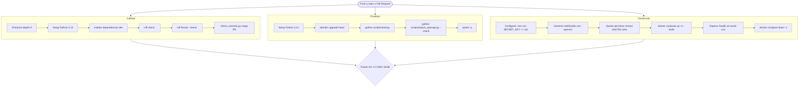

# Documentación de DevOps e Infraestructura — Proyecto PF-04

**Proyecto:** Organización de eventos y actividades académicas (Python · FastAPI · SQLite · Jinja2 · SDD)  
**Asignatura:** Aplicaciones y Servicios Web · Tecnología en Desarrollo de Software  
**Responsable:** Integrante B  
**Requisitos asociados:** RNF-10, RNF-20, RNF-21, RNF-22, RNF-23

Este documento describe la infraestructura DevOps completa del proyecto, cubriendo la contenerización con Docker, el pipeline de Integración Continua (CI) en GitHub Actions, la gestión de certificados TLS para HTTPS obligatorio, los scripts operativos y las políticas de calidad del código.

---

## 1. Filosofía y decisiones de infraestructura

- **Sin dependencia de nube externa:** De acuerdo con la guía de la asignatura, el despliegue en la nube es opcional. El equipo decidió enfocar los esfuerzos en la **reproducibilidad absoluta local y contenerizada**: el proyecto funciona idénticamente en Windows, Linux y macOS, tanto en bare-metal como en contenedores.
- **HTTPS obligatorio en todos los entornos:** La constitución (v2.0.2) exige que la aplicación se sirva siempre por HTTPS (local, Docker, CI y entrega). La cookie de sesión tiene la bandera `Secure` permanentemente activa y la app falla al arrancar si se intenta desactivar.
- **Principio de mínimo privilegio en contenedores:** El contenedor jamás se ejecuta como `root`. Se crea un usuario dedicado sin privilegios (`appuser`, UID 1000).

---

## 2. Contenerización con Docker y Docker Compose

### 2.1 Imagen de Docker (`Dockerfile`)
- **Imagen base:** `python:3.12-slim` (minimalista, segura y libre de herramientas de compilación innecesarias en runtime).
- **Dependencias de desarrollo/pruebas configurables:** mediante `ARG INSTALL_DEV=true` instala `requirements-dev.txt` por defecto para permitir ejecutar `docker compose exec web pytest -q`; para una imagen liviana solo de producción se compila con `--build-arg INSTALL_DEV=false`.
- **Usuario seguro:** Se crea el grupo y usuario `appuser` con UID/GID 1000.
- **Directorio de trabajo:** `/app`, con permisos asignados a `appuser`.
- **Entrypoint:** `scripts/entrypoint.sh` ejecuta automáticamente `alembic upgrade head` para garantizar que la base de datos esté al día antes de iniciar Uvicorn.
- **Comando de arranque:**
  ```bash
  uvicorn app.main:app --host 0.0.0.0 --port 8000 \
    --ssl-keyfile certs/localhost-key.pem \
    --ssl-certfile certs/localhost.pem
  ```
- **Healthcheck nativo:**
  ```dockerfile
  HEALTHCHECK --interval=30s --timeout=5s --start-period=10s --retries=3 \
    CMD python3 -c "import urllib.request, ssl; ctx = ssl._create_unverified_context(); urllib.request.urlopen('https://localhost:8000/health', context=ctx, timeout=4)"
  ```

### 2.2 Orquestación con `docker-compose.yml`
```yaml
services:
  web:
    build: .
    ports:
      - "8000:8000"
    environment:
      - DATABASE_URL=sqlite:///./data/eventos.db
      - COOKIE_SECURE=true
    env_file:
      - .env
    volumes:
      - eventos_data:/app/data
      - ./certs:/app/certs:ro
    restart: unless-stopped

volumes:
  eventos_data:
    name: pf04_eventos_data
```
- **Persistencia SQLite:** El volumen nombrado `eventos_data` monta el directorio `/app/data`, asegurando que la base de datos `eventos.db` sobreviva a reinicios y recreaciones de contenedores.
- **Montaje de certificados:** Los certificados locales se montan en `/app/certs:ro` (solo lectura), preservando la seguridad de las llaves privadas.

---

## 3. Pipeline de Integración Continua (GitHub Actions)

El workflow está definido en `.github/workflows/ci.yml` y se ejecuta automáticamente ante cada `pull_request` y cada `push` a la rama `main`. Consta de 3 jobs paralelos e independientes:



### 3.1 Job `calidad`
1. **Ruff Linter:** `ruff check .` detecta errores de estilo, imports desordenados y potenciales bugs.
2. **Ruff Formatter:** `ruff format --check .` asegura consistencia formal idéntica en los 168 archivos de código.
3. **Validador de Commits:** `scripts/check_commits.py` valida que todos los commits del Pull Request cumplan la convención Conventional Commits en español (`tipo(alcance): descripción`), con longitud de primera línea ≤ 72 caracteres y sin punto final.

### 3.2 Job `pruebas`
1. **Migraciones:** Ejecuta `alembic upgrade head` sobre una base de datos limpia de CI.
2. **Seed:** Ejecuta `python scripts/seed.py` para validar la idempotencia del poblamiento.
3. **Contrato OpenAPI sin desvíos:** `python scripts/export_openapi.py --check` valida que el contrato versionado en `specs/contrato/openapi.json` refleje con exactitud matemática el esquema FastAPI actual.
4. **Pruebas automatizadas:** `pytest -q` corre las 79 pruebas unitarias, de integración y de concurrencia.

### 3.3 Job `docker`
1. Configura el entorno `.env` asegurando una `SECRET_KEY` aleatoria de más de 32 caracteres distinta a `.env.example`.
2. Genera certificados autofirmados TLS para el runner con `openssl` y aplica permisos `chmod 755 certs` y `chmod 644 certs/*.pem`.
3. Construye y levanta el servicio con `docker compose up -d --build`.
4. Sondea en bucle el endpoint seguro `https://localhost:8000/health` hasta confirmar disponibilidad `200 OK`.
5. Ejecuta `docker compose exec -T web pytest -q` dentro del contenedor en ejecución para verificar la suite completa en Docker.

---

## 4. Gestión de Certificados HTTPS locales

El sistema proporciona scripts automatizados en `scripts/` para simplificar la creación de certificados locales:

- **Windows:** `scripts/generar_certificados.ps1` detecta `mkcert` (o `openssl`), instala la CA local en el almacén de Windows y genera `certs/localhost.pem` y `certs/localhost-key.pem`.
- **Linux / macOS:** `scripts/generar_certificados.sh` genera certificados de confianza local con `mkcert` o autofirmados con `openssl`, aplicando permisos `0755` en la carpeta y `0644` en los archivos para compatibilidad con el contenedor Docker.

---

## 5. Scripts de Soporte y Herramientas

| Script | Propósito | Uso |
|---|---|---|
| `scripts/entrypoint.sh` | Entrypoint del contenedor Docker: ejecuta migraciones y arranca Uvicorn con SSL | Automático en Docker |
| `scripts/seed.py` | Puebla la base de datos con cuentas y eventos ficticios reproducibles | `python scripts/seed.py` |
| `scripts/crear_usuario.py` | Crea organizadores o coordinación por CLI pidiendo documento | `python scripts/crear_usuario.py` |
| `scripts/export_openapi.py` | Exporta (`--check`) el contrato OpenAPI oficial a `specs/contrato/openapi.json` | `python scripts/export_openapi.py` |
| `scripts/check_commits.py` | Valida mensajes de commit bajo Conventional Commits en español | Hook git y en CI |
| `scripts/generar_certificados.*` | Genera certificados TLS locales para desarrollo HTTPS | `./scripts/generar_certificados.sh` |
