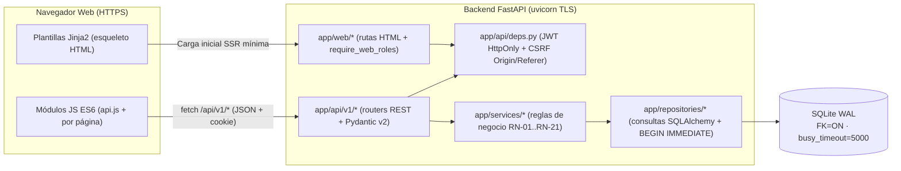
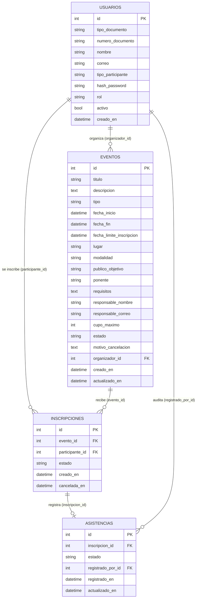

# Diseño técnico y contrato compartido (PF-04)

> **Estado:** Documento completo (**E1** contrato compartido + **E9-A** arquitectura, modelo de datos, especificación de API, justificación tecnológica y prototipos).

## 1. Arquitectura en capas

El proyecto aplica separación estricta de responsabilidades (`RNF-01`):

```text
app/api/v1/ + app/web/   ──►   app/services/   ──►   app/repositories/   ──►   app/models/
  (HTTP / Pydantic)             (Reglas RN)             (Única capa SQL)        (ORM SQLite)
```

- **Routers (`app/api/v1/`):** validan entrada con Pydantic v2, invocan servicios y delegan excepciones al manejador global. No contienen reglas de negocio ni SQL.
- **Servicios (`app/services/`):** implementan todas las reglas `RN-01..RN-21`. **No importan `fastapi`**.
- **Repositorios (`app/repositories/`):** encapsulan consultas SQLAlchemy.

---

## 2. Contrato compartido entre integrantes (congelado desde E1)

Ninguno de estos módulos ni firmas se modifica sin acuerdo previo de ambos integrantes (`AGENTS.md` §4 y principio XI de la constitución).

### 2.1 Base de datos y sesión (`app/core/database.py`)
- `Base`: clase base declarativa de SQLAlchemy.
- `engine`, `SessionLocal`: motor SQLite configurado con `PRAGMA foreign_keys=ON`, `PRAGMA busy_timeout=5000` y `PRAGMA journal_mode=WAL` en cada conexión.
- `get_db() -> Generator[Session, None, None]`: dependencia FastAPI de sesión por solicitud.

### 2.2 Fechas y ventana de asistencia (`app/core/fechas.py`)
- `ZONA_BOGOTA = ZoneInfo("America/Bogota")` · `VENTANA_ASISTENCIA_HORAS = 48`.
- `ahora_utc() -> datetime`: proveedor inyectable de hora actual en UTC para pruebas.
- `asegurar_utc(valor: datetime) -> datetime`: exige zona horaria explícita (`ValueError` → HTTP 422 si es *naive*) y normaliza a UTC.
- `FechaConZona`: tipo anotado Pydantic (`Annotated[datetime, AfterValidator(asegurar_utc)]`).
- `a_bogota(valor: datetime) -> datetime`: convierte a `America/Bogota`.
- `esta_en_ventana_asistencia(fecha_inicio, fecha_fin, *, ahora=None) -> bool`: evalúa `[fecha_inicio, fecha_fin + 48h]` en UTC.
- `UTCDateTime(TypeDecorator)`: persiste fechas en formato ISO UTC fijo (`%Y-%m-%dT%H:%M:%S.%fZ`) para que las restricciones `CHECK` en SQLite comparen de forma fiable.

### 2.3 Enumeraciones (`app/models/enums.py`)
- `Rol`: `participante`, `organizador`, `coordinacion`
- `TipoDocumento`: `CC`, `CE`, `TI`, `PAS`
- `TipoParticipante`: `estudiante`, `docente`
- `TipoEvento`: `conferencia`, `taller`, `seminario`, `capacitacion`
- `Modalidad`: `presencial`, `virtual`, `hibrida`
- `PublicoObjetivo`: `todos`, `estudiantes`, `docentes`
- `EstadoEvento`: `borrador`, `publicado`, `cancelado`
- `EstadoInscripcion`: `activa`, `cancelada`
- `EstadoAsistencia`: `presente`, `ausente`

### 2.4 Errores de dominio (`app/core/errors.py`)
Formato JSON uniforme garantizado por `registrar_manejadores_errores(app)`:

```json
{"error": {"codigo": "...", "mensaje": "...", "detalles": []}}
```

- Jerarquía: `ErrorDominio(codigo, mensaje, status_code=400, detalles=None)` con subclases `NoEncontrado` (404), `NoAutorizado` (403), `NoAutenticado` (401), `Conflicto` (409), `ReglaNegocio` (422) y `DemasiadosIntentos` (429).
- `RequestValidationError` devuelve 422 `ERROR_VALIDACION` **omitiendo el campo `input`** para evitar filtrar contraseñas o documentos.
- Códigos oficiales (`CodigosError`):
  - `409`: `DOCUMENTO_DUPLICADO`, `INSCRIPCION_DUPLICADA`, `CUPO_AGOTADO`, `INSCRIPCIONES_CERRADAS`, `PUBLICO_NO_PERMITIDO`, `CANCELACION_NO_PERMITIDA`, `ASISTENCIA_NO_PERMITIDA`, `EVENTO_NO_PUBLICADO`
  - `404`: `EVENTO_NO_ENCONTRADO`, `INSCRIPCION_NO_ENCONTRADA`
  - `403`: `SIN_PERMISO`
  - `401`: `CREDENCIALES_INVALIDAS`
  - `429`: `DEMASIADOS_INTENTOS`

### 2.5 Dependencias de autenticación (`app/api/deps.py`)
- `get_current_user_optional(request, db) -> Usuario | None`: decodifica la cookie JWT `pf04_session` verificando firma, expiración y `usuario.activo`.
- `get_current_user(usuario) -> Usuario`: exige usuario autenticado y activo (`401 CREDENCIALES_INVALIDAS`).
- `require_roles(*roles: Rol) -> Callable[[Usuario], Usuario]`: exige rol autorizado (`403 SIN_PERMISO`).
- `require_web_user` / `require_web_roles(*roles: Rol)`: equivalentes para vistas web; sin sesión redirigen `303` a `/login`, y con rol insuficiente responden `403 SIN_PERMISO`.
- `verificar_csrf(request)`: registrada globalmente en `api_router`; exige `Origin` válido (o `Referer` como respaldo) frente a `ALLOWED_ORIGINS` y origen efectivo en toda mutación (`POST`/`PUT`/`PATCH`/`DELETE`) que envíe cookie de sesión (`403 SIN_PERMISO` si falta o no coincide; en `pytest` enviar `Origin: https://testserver`).

### 2.6 Conteo compartido de inscripciones (`app/repositories/inscripcion_repo.py`)
- `contar_activas(db: Session, evento_id: int) -> int`
- `contar_activas_por_eventos(db: Session, ids: Sequence[int]) -> dict[int, int]`

### 2.7 Cliente frontend común (`app/static/js/api.js`)
- `requestApi(ruta, opciones)`: envuelve `fetch('/api/v1' + ruta, { credentials: 'same-origin' })`, interpreta `{"error": ...}` y redirige a `/login` ante 401.
- `formatearFechaBogota(isoFecha)` y `aIsoBogota(valorLocal)`: presentación y envío explícito en `America/Bogota` (`-05:00`).
- `mostrarAlerta`, `ocultarAlerta`, `crearNodo`: manipulación DOM segura usando exclusivamente `textContent`.

---

## 3. Diagrama de Componentes y Flujo de Solicitud



---

## 4. Modelo de Datos y Reglas de Integridad (SQLite + Alembic)

El esquema relacional se gestiona con migraciones versionadas en `migrations/` y modelos ORM en `app/models/`. Cada conexión habilita `PRAGMA foreign_keys=ON`, `PRAGMA busy_timeout=5000` y `PRAGMA journal_mode=WAL`. Todas las fechas se almacenan normalizadas en **UTC** mediante `UTCDateTime`.



### Restricciones e índices críticos en base de datos

| Tabla | Restricciones e índices verificados en ORM (`app/models/`) |
|---|---|
| `usuarios` | PK `id`; `UNIQUE(tipo_documento, numero_documento)` (`uq_usuarios_documento`); `CHECK` de longitud de documento (5..15), `tipo_documento` (`CC`, `CE`, `TI`, `PAS`), `rol` (`participante`, `organizador`, `coordinacion`) y `tipo_participante` (`estudiante`, `docente` o `NULL`). |
| `eventos` | PK `id`; FK `organizador_id → usuarios.id` (`RESTRICT`); `CHECK` `cupo_maximo >= 1`, `fecha_fin > fecha_inicio`, `fecha_limite_inscripcion <= fecha_inicio`, `estado` (`borrador`, `publicado`, `cancelado`), `tipo`, `modalidad` y `publico_objetivo`; índices `ix_eventos_estado_inicio` y `ix_eventos_organizador`. |
| `inscripciones` | PK `id`; FKs `evento_id → eventos.id` y `participante_id → usuarios.id` (`RESTRICT`); `CHECK` `estado IN ('activa', 'cancelada')`; **índice único parcial** `ux_inscripciones_activa` sobre `(evento_id, participante_id)` `WHERE estado = 'activa'` (permite reinscripción tras cancelar pero impide dos inscripciones activas simultáneas). |
| `asistencias` | PK `id`; FK `inscripcion_id → inscripciones.id` (`RESTRICT`) con `UNIQUE(inscripcion_id)` (`uq_asistencias_inscripcion`); FK `registrado_por_id → usuarios.id` (`RESTRICT`); `CHECK` `estado IN ('presente', 'ausente')`. |

**Control atómico de cupos (`RNF-04`):** la inscripción abre transacción inmediata con `BEGIN IMMEDIATE` en SQLite y ejecuta una inserción condicional `INSERT INTO inscripciones ... SELECT ... WHERE (SELECT COUNT(*) FROM inscripciones WHERE evento_id = :id AND estado = 'activa') < :cupo_maximo`, verificando `rowcount == 1`. Si otro hilo consume el último cupo antes de confirmar, devuelve `409 CUPO_AGOTADO` sin dejar registros parciales.

---

## 5. Especificación de API REST (`/api/v1`) y Vistas Web

El contrato formal generado desde la aplicación se encuentra versionado en [specs/contrato/openapi.json](../specs/contrato/openapi.json) y disponible interactivamente en `https://localhost:8000/docs`.

### 5.1 Endpoints REST principales

| Módulo | Método y ruta | Rol / Seguridad | Respuestas principales |
|---|---|---|---|
| **Salud** | `GET /health` | Público | `200` estado del servicio y BD |
| **Auth** | `POST /api/v1/auth/registro`, `POST /api/v1/auth/login` | Público (rate limit 10 fallos → `429`) | `201`/`200`, `401`, `409`, `422`, `429` |
| **Auth** | `POST /api/v1/auth/logout`, `GET /api/v1/auth/yo` | Autenticado + CSRF (`POST`) | `200`/`204`, `401`, `403` |
| **Eventos** | `GET /api/v1/organizador/eventos`, `POST /api/v1/eventos`, `GET\|PUT\|PATCH /api/v1/eventos/{evento_id}`, `POST /api/v1/eventos/{evento_id}/publicar`, `POST /api/v1/eventos/{evento_id}/cancelar` | `organizador` propietario + CSRF en mutaciones | `200`/`201`, `401`, `403`, `404`, `409`, `422` |
| **Catálogo** | `GET /api/v1/catalogo/eventos`, `GET /api/v1/catalogo/eventos/{evento_id}` | Público (solo publicados) | `200`, `404` (`EVENTO_NO_ENCONTRADO`), `422` |
| **Inscripciones** | `POST /api/v1/eventos/{evento_id}/inscripciones`, `GET /api/v1/inscripciones/mias`, `PATCH /api/v1/inscripciones/{inscripcion_id}/cancelar` | `participante` propietario + CSRF en mutaciones | `201`/`200`, `401`, `403`, `404`, `409` (`CUPO_AGOTADO`, `INSCRIPCION_DUPLICADA`, etc.) |
| **Inscripciones** | `GET /api/v1/eventos/{evento_id}/inscripciones` | `organizador` dueño o `coordinacion` (enmascarado) | `200`, `401`, `403`, `404` |
| **Asistencia** | `PUT /api/v1/eventos/{evento_id}/inscripciones/{inscripcion_id}/asistencia` | `organizador` dueño en ventana `[inicio, fin+48h]` + CSRF | `200`, `401`, `403`, `404`, `409` (`ASISTENCIA_NO_PERMITIDA`) |
| **Asistencia** | `GET /api/v1/eventos/{evento_id}/asistencia` | `organizador` dueño o `coordinacion` (enmascarado) | `200`, `401`, `403`, `404` |
| **Reportes** | `GET /api/v1/reportes/consolidado`, `GET /api/v1/reportes/consolidado/csv` | `coordinacion` solo lectura | `200` (JSON / `text/csv` sanitizado), `401`, `403`, `422` |

### 5.2 Vistas Web (`app/web/`)

- **Públicas:** `/` (catálogo), `/eventos/{evento_id}` (detalle y `404` amigable), `/login`, `/registro`.
- **Participante:** `/mis-inscripciones`.
- **Organizador:** `/organizador/eventos`, `/organizador/eventos/nuevo`, `/organizador/eventos/{evento_id}/editar`.
- **Organizador / Coordinación:** `/eventos/{evento_id}/asistencia`.
- **Coordinación:** `/coordinacion/consolidado`.

---

## 6. Enlaces a Especificaciones SDD (Spec Kit)

- Constitución del proyecto: [.specify/memory/constitution.md](../.specify/memory/constitution.md)
- Índice y puertas G1–G5: [specs/README.md](../specs/README.md)
- **E1 — Fundación:** [specs/001-fundacion/](../specs/001-fundacion/spec.md)
- **E2 — Autenticación y roles:** [specs/002-autenticacion-roles/](../specs/002-autenticacion-roles/spec.md)
- **E3 — Gestión de eventos:** [specs/003-gestion-eventos/](../specs/003-gestion-eventos/spec.md)
- **E4 — Catálogo y consulta:** [specs/004-catalogo-eventos/](../specs/004-catalogo-eventos/spec.md)
- **E5 — Inscripciones y cupos:** [specs/005-inscripciones-cupos/](../specs/005-inscripciones-cupos/spec.md)
- **E6 — Asistencia:** [specs/006-asistencia/](../specs/006-asistencia/spec.md)
- **E7 — Consolidado:** [specs/007-consolidado/](../specs/007-consolidado/spec.md)
- **E10 — DevOps, CI y Docker:** [specs/010-devops-ci-docker/](../specs/010-devops-ci-docker/spec.md)

