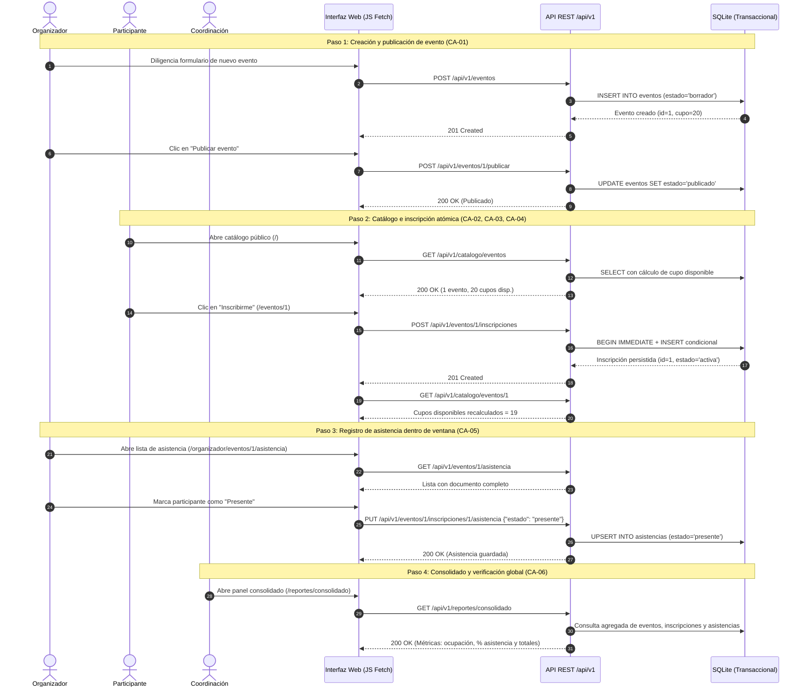

# Prueba Funcional PF-12 — Flujo integral completo interfaz–API–BD

- **Identificador:** PF-12
- **Épica origen:** Transversal (E1 a E7, E8-B)
- **Condiciones cubiertas:** `CA-01`, `CA-02`, `CA-03`, `CA-04`, `CA-05`, `CA-06`
- **Requisitos asociados:** RF-27, RNF-01, RNF-02, RNF-04, RNF-05, RNF-06, RNF-07, RNF-16
- **Responsables:** Integrante A e Integrante B (ejecución y validación conjunta)
- **Herramienta utilizada:** Cliente HTTP HTTPS (`TestClient` sobre `https://testserver`), inspección de tablas en SQLite y navegación interactiva web (`https://localhost:8000`)
- **Estado actual:** Ejecutada y aprobada (flujo integral de ciclo de vida completo verificado)

---

## 1. Objetivo del flujo

Demostrar de forma verificable la **comunicación real y consistente** entre las tres capas del sistema:
1. **Interfaz Web:** Plantillas Jinja2 renderizadas como esqueleto y módulos JavaScript (`api.js`, `catalogo.js`, `eventos.js`, `asistencia.js`, `reportes.js`) que consumen asíncronamente `/api/v1` mediante `fetch` sin recargar página y manipulando el DOM con `textContent` seguro (prevención de XSS).
2. **Backend API REST:** Arquitectura en capas (`api` → `services` → `repositories` → `models`) con autorización por rol y propietario, errores uniformes y validación de esquemas Pydantic v2.
3. **Base de Datos SQLite:** Persistencia real con claves foráneas activas (`PRAGMA foreign_keys = ON`), transacciones atómicas (`BEGIN IMMEDIATE`), índices únicos y almacenamiento de marcas temporales normalizadas en UTC.

---

## 2. Secuencia de pasos del ciclo de vida completo



---

## 3. Detalle de verificación por etapa

### Etapa 1: Autenticación y creación del evento (`CA-01`)
- **Acción:** El usuario organizador (`CC 1000000102`) inicia sesión y crea una actividad académica (`POST /api/v1/eventos`) con título `"Conferencia Internacional de IA"`, modalidad `"presencial"`, cupo máximo de 20 y fechas válidas en formato ISO con zona `-05:00`.
- **Publicación:** Se ejecuta `POST /api/v1/eventos/{id}/publicar`. La API valida que el inicio sea futuro y que los campos requeridos estén completos. El evento pasa a `publicado`.
- **Verificación en BD:**
  ```sql
  SELECT id, titulo, estado, cupo_maximo, fecha_inicio, fecha_fin FROM eventos WHERE id = :id;
  ```
  Resultado: `estado = 'publicado'`, fechas almacenadas en formato UTC ISO (`%Y-%m-%dT%H:%M:%S.%fZ`).

### Etapa 2: Visualización en catálogo y disponibilidad (`CA-02`)
- **Acción:** El participante navega al catálogo (`GET /api/v1/catalogo/eventos`).
- **Verificación:** El evento aparece con `estado_efectivo = "publicado"`, `cupo_maximo = 20`, `inscripciones_activas = 0` y `cupos_disponibles = 20`. Los eventos en `borrador` o `cancelado` no aparecen en el catálogo.

### Etapa 3: Inscripción con reserva atómica de cupo (`CA-03`, `CA-04`)
- **Acción:** El participante (`CC 1000000101`) envía `POST /api/v1/eventos/{id}/inscripciones`.
- **Verificación:**
  - Respuesta HTTP **201 Created** con `estado = "activa"`.
  - Nueva fila insertada en `inscripciones` vinculando `(evento_id, participante_id)`.
  - La consulta posterior a `GET /api/v1/catalogo/eventos/{id}` refleja de inmediato:
    `inscripciones_activas = 1`, `cupos_disponibles = 19`.

### Etapa 4: Registro y corrección de asistencia (`CA-05`)
- **Acción:** Durante la ventana válida del evento (`fecha_inicio <= ahora <= fecha_fin + 48h`), el organizador accede a la nómina de inscritos y marca la asistencia con estado `"presente"`.
- **Verificación:**
  - HTTP **200 OK** con registro en tabla `asistencias`.
  - Intento de acceso por otro organizador responde HTTP **403 Forbidden**.
  - Corrección de estado no duplica filas en base de datos (`UPSERT`).

### Etapa 5: Reporte consolidado para coordinación (`CA-06`)
- **Acción:** Usuario con rol `coordinacion` accede a `GET /api/v1/reportes/consolidado`.
- **Verificación:**
  - El evento reporta: `cupo_maximo = 20`, `inscripciones_activas = 1`, `cupos_disponibles = 19`, `ocupacion_porcentaje = 5.0%`, `asistencias_presentes = 1`, `asistencias_ausentes = 0`, `asistencias_sin_registrar = 0`, `asistencia_porcentaje = 100.0%`.
  - El bloque `totales` cuadra exactamente con la suma del detalle individual.
  - La exportación a CSV genera un archivo estructurado con sanitización de inyección de fórmulas.

---

## 4. Evidencia de integridad y seguridad

- **Integridad referencial SQLite:** `PRAGMA foreign_key_check` retorna 0 violaciones.
- **Seguridad en red y cookies:** Cookie `pf04_session` con banderas `HttpOnly`, `SameSite=Lax` y `Secure`.
- **Protección XSS:** Interfaz Jinja2 sin `innerHTML` dinámico con datos de usuario; módulos JavaScript utilizando exclusivamente `textContent` y `crearNodo` de `api.js`.
- **Prueba automatizada integrada:** Cobertura complementaria en `tests/test_scripts_web.py` y suite completa de 77 pruebas en verde.
